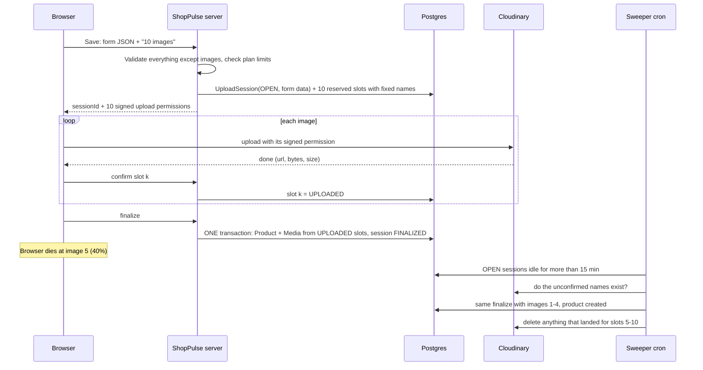

## Part 1: Image asal mein kya hai?

- Image bas ek **file** hai, jaise PDF ya gaana. Uske andar sirf numbers (bytes) hote hain. 2 MB ki photo matlab lagbhag 20 lakh bytes.
- Seller "Choose file" se photo chunta hai toh photo **uske laptop se browser tab ki memory (RAM) mein** aati hai. Internet par abhi kahin nahi gayi.
- Preview ke liye browser ek temporary link banata hai, jaise `blob:http://localhost:3000/8f2c...`. Ye link **sirf usi tab mein** chalta hai. Tab band hote hi link aur photo dono memory se chale jaate hain.

> **Yaad rakho:** Select karna aur upload karna alag cheezein hain. Select ka matlab photo tumhare browser mein hai. Upload ka matlab photo internet par kisi server tak pahunch gayi.

---

## Part 2: Image Postgres DB mein kyun nahi rakhte?

Rakh toh sakte ho, par koi nahi rakhta:
- DB chhote aur structured data ke liye bana hai, jaise naam, price, stock.
- Ek product ki 8 photos lagbhag 16 MB hoti hain. 1000 products ho gaye toh 16 GB sirf photos ka. DB slow ho jaata hai, backup bhaari aur mehnga.
- Har customer product page khole toh DB ko MBs bhejne padenge. DB par bahut bojh padega.

**Industry ka tareeka:**
- **Photo** ek alag file-storage service par rakhte hain, jaise Cloudinary, AWS S3 ya Cloudflare R2.
- **DB mein sirf photo ka link (URL)** aur thodi info rakhte hain: size, width, height.

> **Analogy:** Phone ke contacts mein dost ka **number** save hota hai, dost khud phone mein nahi rehta. DB contacts list hai, Cloudinary wo jagah hai jahan photo asal mein rehti hai.

---

## Part 3: Cloudinary ke 5 words

Cloudinary ko developers ke liye images ka Google Drive samjho.

| Word | Matlab | ShopPulse mein example |
|---|---|---|
| Cloud name | Tumhare Cloudinary account ka naam | env var `NEXT_PUBLIC_CLOUDINARY_CLOUD_NAME` |
| **public_id** | Cloudinary ke andar photo ka **naam + folder path** (unique hota hai) | `shoppulse/store_abc/products/red-shirt-1-18f3a` |
| secure_url | Photo ka public link jise browser khol sakta hai | `https://res.cloudinary.com/<cloud>/image/upload/v17300.../shoppulse/store_abc/products/red-shirt-1-18f3a.jpg` |
| Folder | public_id ka shuru wala hissa, bas organise karne ke liye | `shoppulse/{storeId}/products` (`cloudinary.ts` mein `getCloudinaryFolder`) |
| Transformation | URL mein chhota code daal kar photo resize ya compress karwana | `.../upload/f_auto,q_auto,w_400/...` se 400px chaudi photo milti hai |

Do aur baatein:
- **CDN:** Cloudinary photo ki copies duniya bhar ke servers par rakhta hai. Mumbai ka customer paas wale server se photo leta hai, isliye page jaldi khulta hai.
- **Photo delete karne ke liye uska public_id (naam) chahiye.** Naam nahi pata toh photo dhoond kar delete nahi kar sakte. **Ye baat aage sabse zaroori banegi.**

---

## Part 4: Photo Cloudinary tak kaise pahunchti hai? (2 raaste)

**Raasta A, server ke through:** Browser se hamara server, phir server se Cloudinary.
Dikkat ye hai ki 16 MB hamare server se guzrega. Vercel par ek request lagbhag 4.5 MB tak hi le sakti hai. Server slow bhi hoga aur mehnga bhi.

**Raasta B, direct upload (industry standard):** Browser photo seedha Cloudinary ko bhejta hai. Hamare server par photo ka bojh aata hi nahi.
ShopPulse admin aur storefront dono yahi raasta use karte hain.

Raasta B mein ek sawaal uthta hai: Cloudinary kaise maane ki ye upload allowed hai? Koi bhi aakar upload na kar de?

---

## Part 5: Permission — Unsigned vs Signed upload

Cloudinary ko ek building samjho jiske gate par entry chahiye.

**Unsigned upload ("upload preset"):**
- Gate ka ek common code hai, yaani preset ka naam. Jiske paas code hai wo andar jaa sakta hai.
- Ye code browser ke JavaScript mein hota hai, kyunki `NEXT_PUBLIC_` wale env vars browser tak pahunchte hain. Thoda technical banda bhi ise dekh sakta hai.
- **Admin app abhi yahi use karta hai.**

**Signed upload:**
- Gate par guard khada hai. Andar jaane ke liye **hamare server se pass** lena padta hai.
- Pass par likha hota hai: "sirf is folder mein, sirf is naam se, sirf agle 1 ghante tak".
- Pass par ek stamp (signature) hota hai jo hamare secret `CLOUDINARY_API_SECRET` se banta hai. Secret sirf server ke paas rehta hai, browser ko kabhi nahi milta.
- Koi pass mein naam ya folder badle toh stamp match nahi karega aur Cloudinary upload reject kar dega.
- **Storefront ki return photos abhi yahi use karti hain** (`return-photo-upload.ts`).

> **Yaad rakho:** Signed upload mein **server ko pehle se pata hota hai ki kaunsi photo, kis naam se aane wali hai.** Unsigned mein server ko kuch pata nahi hota. Poora solution isi farak par tika hai.

---

## Part 6: ShopPulse ADMIN abhi kya karta hai (product ka example)

Files:
- `image-upload.tsx`: screen par dikhne wala photo box.
- `use-deferred-upload.ts`: photos yaad rakhta hai aur upload karta hai.
- `product-form.tsx`: Save button ka logic.

Seller 10 photos chunke Save dabata hai. Uske baad:

1. Photos sirf browser memory mein hain, blob preview ke saath (Part 1).
2. Save dabate hi browser server se poochta hai: "product limit bachi hai?" aur "storage bachi hai?"
3. Browser **ek-ek karke** photos Cloudinary ko bhejta hai (unsigned). Har photo ke baad Cloudinary batata hai: "ye raha secure_url, size, width, height".
4. Ye jawab **browser ki memory mein ek list** mein jama hote rehte hain. **Server ko abhi tak kuch nahi pata.**
5. Saari 10 photos ho jaane par browser server ko ek request bhejta hai: poora form (naam, price, variants) + 10 URLs.
6. Server DB mein 1 Product row aur 10 Media rows banata hai.
7. Agar step 5 fail ho jaaye toh browser `cleanup-images` route se kehta hai "ye photos Cloudinary se hata do".

```
Seller ka browser ──(photos ek-ek karke)──► Cloudinary
      │   URLs browser ki memory mein jama
      └──(form + URLs, sabse AAKHIR mein)──► Server ──► DB
```

**Key point:** Server ko sab kuch sirf step 5 par, **sabse aakhir mein** pata chalta hai.

Billboard, Category, Banner, Upcoming aur Reject-evidence bhi isi tarah kaam karte hain, bas 1 photo ke saath.

---

## Part 7: STOREFRONT kya karta hai

**Kaam 1: photos dikhana (sabse common).**
- Storefront admin ki API se product leta hai. Usme Media ke URLs aate hain.
- cloudinary-utils.ts URL mein transformation jodta hai: product card ke liye chhoti photo, gallery ke liye badi.
- `next.config.ts` mein `res.cloudinary.com` allowed hai, aur `next/image` component photo dikhata hai.
- Storefront khud koi photo store nahi karta.

**Kaam 2: customer ki return photos upload karna.**
1. Customer photo chunta hai.
2. Storefront admin server se pass maangta hai. Server check karta hai ki customer sach mein is order ka hai, phir signed pass deta hai.
3. Customer ka browser photo seedha Cloudinary par bhejta hai.
4. URL storefront ke browser mein return basket mein rehta hai.
5. Customer "Submit return" dabata hai. URLs server par jaate hain aur `ReturnRequest.customerImages` mein save hote hain.

Dikkat: customer step 3 ke baad bina submit kiye chala gaya toh photos Cloudinary par padi reh jaati hain. Server ne pass toh diya tha, par **kahin likh ke nahi rakha ki pass diya**, isliye baad mein use kuch yaad nahi.

---

## Part 8: "Orphan" image kya hai aur buri kyun hai

**Orphan** wo photo hai jo Cloudinary par padi hai, par jiska link hamare DB ki **kisi bhi row** mein nahi hai.

> **Analogy:** Airport par bina tag wala bag. Kiska hai, kahan jaana hai, kisi ko nahi pata.

Buri kyun:
1. **Paisa:** Cloudinary storage ke paise leta hai.
2. **Seller ki storage limit bharti hai:** weekly `reconcile-storage` cron Cloudinary par asli size ginta hai aur usi ko sach maanta hai (`route.ts:224`). Orphans bhi gine jaate hain, toh seller ki storage bina wajah bharti hai.
3. **Delete bhi nahi kar sakte:** delete ke liye naam (public_id) chahiye (Part 3). DB mein record hi nahi, toh naam pata nahi. Photo hamesha wahin padi rahegi.
4. **Privacy:** return photos mein customer ka ghar ya chehra ho sakta hai. Aisi photo ka bekaar pade rehna theek nahi.

---

## Part 9: Tumhara scenario, abhi ke code mein

10 photos, 4 poori upload ho gayi, 5th 40% par thi, aur browser band ho gaya:

| Cheez | Kya haal hua |
|---|---|
| Photo 1–4 | Cloudinary par pahunch gayi |
| Photo 1–4 ke URLs | Browser memory mein the. Tab band hua toh **gayab** |
| Photo 5 | Aadhi gayi thi, connection toota, toh Cloudinary ne use phenk diya (aadhi file save nahi hoti) |
| Photo 6–10 | Kabhi gayi hi nahi |
| Form data (naam, price) | Browser memory mein tha, **gayab** |
| Server / DB | Kuch nahi pata. Product nahi bana |

Result: **4 orphan photos, aur product bhi nahi bana.** Do nuksaan ek saath.

"Par alert toh lagaya hai na?" `beforeunload` alert sirf normal close (X button) par "Are you sure?" poochta hai. Seller "Leave" daba de toh tab band ho jaata hai. Battery khatam ho, browser crash ho, Task Manager se band kiya jaaye, ya Wi-Fi chala jaaye, toh alert ya toh chalta hi nahi, ya server tak kuch pahunch nahi paata.

> **Is poore topic ka sabse bada lesson:**
> Jo kaam browser ko **aakhir mein** karna hai, uski koi guarantee nahi, kyunki browser kabhi bhi band ho sakta hai.
> **Guarantee sirf server + DB de sakte hain.** Wo hamesha chalu rehte hain aur DB ki yaadasht band hone par mitti nahi.

Isliye browser ke code se ye problem kabhi poori solve nahi hogi. Tumhare NOTE mein bhi yahi likha tha.

---

## Part 10: Solution ka idea — Godown aur Munshi ki kahani

| Kahani mein | Asal system mein |
|---|---|
| **Godown** | Cloudinary |
| **Godown ka guard** | Cloudinary ka signature check |
| **Dukaan ka register** | Hamara Postgres DB |
| **Munshi (clerk)** | Hamara server (API routes) |
| **Delivery boy** | Seller ka browser |
| **Gate pass** | Signed upload |
| **Checker** | Sweeper cron: har 10 minute chalne wala background job |

### Purana tareeka (abhi ka)
Delivery boy ke paas godown ki master chaabi hai (unsigned preset). Wo maal godown mein rakhta jaata hai aur list apni jeb ki diary mein likhta hai. Sab rakhne ke baad dukaan aakar munshi ko diary dikhata hai.
Beech mein boy behosh ho gaya toh maal godown mein pada hai, diary kho gayi, aur munshi ko kuch nahi pata. **Yahi orphan hai.**

### Naya tareeka: sirf 2 rules

**Rule 1: Pehle register mein entry, phir godown mein maal.**
- Boy pehle munshi ke paas aata hai: "Red Shirt banana hai, ye rahi details (naam, price), aur 10 photos hain."
- Munshi register mein likhta hai:
  - "Order S1: Red Shirt, details {...}, status: **CHAL RAHA HAI**"
  - "Parcel 1: naam `red-shirt-1-x7`, status: **AANA BAAKI**"
  - ...aur isi tarah Parcel 10 tak.
- Munshi boy ko 10 gate pass deta hai. Har pass par ek fixed naam likha hai.
- Godown ka guard sirf munshi ke pass wala maal leta hai, aur sirf usi naam se.

**Iska nateeja:** godown mein aisi koi cheez aa hi nahi sakti jo register mein pehle se na ho. Bina entry ke pass nahi milta, aur bina pass ke godown mein entry nahi hoti.

**Rule 2: Checker adhoora kaam poora karta hai.**
- Har parcel rakhne ke baad boy munshi ko phone karta hai: "Parcel 1 rakh diya." Munshi register mein tick lagata hai: **AA GAYA**.
- Saare parcel ho gaye toh boy kehta hai "finish karo". Munshi saare ticked parcels se product bana deta hai aur order ko **POORA** likh deta hai.
- Agar boy beech mein gayab ho jaaye, toh checker har 10 minute register dekhta hai: "Order S1 mein 15 minute se boy ka phone nahi aaya. Matlab boy gaya."
  - Ticked parcels (1–4) se product bana deta hai.
  - Bina tick wale parcels (5–10) ke liye godown ko phone karta hai: "`red-shirt-5` naam ka kuch pada hai?" Haan hai toh hata deta hai, nahi hai toh register mein kaat deta hai.
  - Checker ye sab isliye kar paata hai kyunki **naam munshi ne khud rakhe the**. Boy ki zaroorat hi nahi padti.

**Bas, poora solution itna hi hai.** Aage sab details hain.

---

## Part 11: Wahi kahani, asli system mein (tumhara scenario)

DB mein 2 naye tables banenge, jaise register ke 2 page.

**`UploadSession`**: har "Save" click ki ek row (order wali entry)

| id | store | purpose | formData | status | lastActivityAt |
|---|---|---|---|---|---|
| S1 | store_abc | PRODUCT | `{name:"Red Shirt", price:999, ...}` | OPEN | 10:00:00 |

**`UploadSlot`**: har photo ki ek row (parcel wali entry)

| id | session | position | publicId (naam) | status |
|---|---|---|---|---|
| p1 | S1 | 1 | shoppulse/store_abc/products/red-shirt-1-x7 | RESERVED |
| ... | | | | |
| p10 | S1 | 10 | .../red-shirt-10-x7 | RESERVED |

`RESERVED` ka matlab: naam book ho gaya, photo abhi aayi nahi.

### Timeline

**10:00:00, Save click.** Browser server ko form data aur 10 photos ki info (size, type) bhejta hai. Server:
- Form check karta hai: naam khaali toh nahi, price sahi hai, SKU duplicate toh nahi, plan limit bachi hai. Kuch galat hai toh yahin mana kar deta hai, aur koi photo upload hi nahi hoti.
- Sab sahi hai toh upar wali 11 rows DB mein likhta hai.
- Browser ko 10 signed pass deta hai.

**10:00:02, photo 1 Cloudinary par pahunch gayi.** Browser server ko batata hai "slot p1 confirm". Server p1 ko `UPLOADED` kar deta hai, uska url/bytes/width/height save karta hai, aur `lastActivityAt` update karta hai. Photo 2, 3 aur 4 ke saath bhi yahi hota hai.

**10:00:09, photo 5 40% par thi aur laptop band ho gaya.**
- DB mein: S1 `OPEN`, p1–p4 `UPLOADED`, p5–p10 `RESERVED`.
- Cloudinary par: 4 photos (aadhi photo 5 phenk di gayi).
- **Cloudinary ki har photo ka naam DB mein maujood hai. Ek bhi orphan nahi.**

**10:10, sweeper chala.** S1 mein 10 minute se koi activity nahi, par abhi 15 minute nahi hue, toh chhod diya.

**10:20, sweeper phir chala.** S1 20 minute se chup hai, matlab browser gaya.
- p5–p10 ke naam Cloudinary se poochta hai (ek call mein 100 naam tak pooch sakte hain). Kuch nahi mila, toh p5–p10 `DISCARDED`.
- `UPLOADED` photos 4 hain, yaani kam se kam 1, toh product banega.
- **Ek DB transaction** mein: formData se Product row, p1–p4 ke URLs se 4 Media rows (wahi order), p1–p4 `ATTACHED`, aur S1 `FINALIZED`.

**Result:** Red Shirt 4 photos ke saath ban gaya. Cloudinary par 4 photos, DB mein 4 links. **Ye bilkul tumhari chahi hui flow hai.**

**Transaction kya hai?** DB ka "ya toh sab save, ya kuch nahi" mode. Product ban gaya aur Media likhte waqt error aaya, toh Product bhi wapas hat jaata hai. Aadha-adhoora kabhi save nahi hota.

**Browser band na hota toh?** Photo 10 ke baad browser khud "finalize" bolta, wahi transaction turant chalti, aur product turant ban jaata. Sweeper ki zaroorat hi nahi padti.

---

## Part 12: Har gadbad mein kya hoga

1. **Ek bhi photo upload nahi hui aur browser band ho gaya.** `UPLOADED` 0 hain, toh product nahi banega aur S1 `ABANDONED` ho jaayega. Ye wahi case hai jaise seller "Images are required" wala error dekhta hai.
2. **Photo 5 Cloudinary par 100% pahunch gayi, par jawab browser tak aane se pehle browser band ho gaya.** Ye sabse tricky case hai. p5 abhi `RESERVED` hai, par sweeper Cloudinary se poochta hai "`red-shirt-5` hai?" Jawab haan, toh photo ya product mein jud jaati hai ya delete hoti hai. Dono tarah orphan nahi bachta. **Ye sirf isliye mumkin hai kyunki naam pehle se register mein tha.**
3. **Seller ne normal X dabaya.** Band hote waqt browser ek aakhri chhoti request bhej sakta hai (`navigator.sendBeacon`, yaani "jaate jaate ek chitthi daal do"). Wo server ko kehti hai "abhi finalize karo", toh product turant ban jaata hai.
4. **Battery khatam, crash, ya Task Manager se kill.** Koi chitthi nahi jaati. Sweeper 15–25 minute mein kaam kar deta hai.
5. **Browser aur sweeper dono ek saath finalize karne lage.** Dono status `OPEN → FINALIZING` karne ki koshish karte hain, is shart ke saath ki "sirf tab badlo jab abhi `OPEN` ho". DB ek waqt mein ek hi ko jeetne deta hai. Haarne wala dekhta hai "ho chuka hai" aur ruk jaata hai. Product do baar nahi banta. Iska naam **compare-and-set** hai.
6. **Finalize ke waqt product limit khatam ho gayi ya SKU duplicate nikla.** Product nahi ban sakta, toh S1 `FAILED` aur p1–p4 `DISCARD`. Sweeper unhe Cloudinary se delete karta hai. Cloudinary us waqt down ho toh row `DISCARD` hi rehti hai aur agli baar phir try hota hai. Register mein likha hai, isliye ye kabhi bhoola nahi jaata.
7. **Product edit kiya: 2 purani photos hatayi, 3 nayi daali.** Session mein `productId` bhi likha hota hai. Finalize par 3 nayi photos jud jaati hain aur 2 purani hatti hain, **pehle DB se, phir Cloudinary se**.

### "Pehle DB, phir Cloudinary delete" kyun?
- **Ulta karo** toh Cloudinary se photo udd jaati hai, phir DB update fail ho jaaye toh product page par tooti hui image dikhti hai. Ye galti theek nahi ho sakti.
- **Seedha karo** toh DB update ho gaya, aur Cloudinary delete fail bhi hua toh bas ek extra photo padi hai jiska naam register mein `DISCARD` likha hai. Sweeper baad mein hata dega. Ye galti apne aap theek ho jaati hai.

### Aakhri safety net (weekly)
Cloudinary ke `shoppulse/` folder ki saari files ki list ko DB ke saare naamon se milao. Jo file Cloudinary par hai par DB mein kahin nahi, aur 1 din se purani hai, use delete kar do. Isse kisi bhi bug se bacha orphan pakda jaata hai. Ye kaam existing `reconcile-storage` cron mein jod sakte hain.

---

## Part 13: Reusable kaise banega — ek munshi, alag-alag kaam

Godown, register, munshi aur checker ka ye system sirf product ke liye nahi hai. Har jagah sirf kaam ka **type** badalta hai. Register ki har entry mein likha hoga **purpose**, yaani ye upload kis kaam ke liye hai.

Har purpose ke liye sirf 3–4 cheezein alag hoti hain:

| Purpose | Kaun upload kar sakta hai | Adhoora reh gaya toh | Poora hone par kya karna |
|---|---|---|---|
| Product photos | Seller (login ke saath) | Jitni aayi unse product bana do (kam se kam 1) | Product + Media rows |
| Billboard / Category / Banner / Upcoming | Seller | Photo aa gayi toh save, nahi toh kuch nahi | Us row mein image ka link set karna |
| Return photos (storefront) | Customer (order session) | **Sab phenk do**, kyunki return submit hi nahi hua | ReturnRequest mein jodna |
| QC inspection photos | Seller | Phenk do | Inspection record mein jodna |
| Reject evidence | Seller | Phenk do | Rejection record mein jodna |

Code mein ye ek **registry** (list) file hogi. Koi naya feature aaye, jaise order hub evidence, toh bas list mein ek entry aur ek "poora hone par kya karna" function likhna hoga. Pass dena, upload, confirm, sweeper aur delete ka code **sirf ek baar** likha jaayega aur sab features usi ko use karenge.

Browser ki taraf bhi ek hi hook hoga (maan lo `useUploadSession`). Admin ka photo box aur storefront ka return photo box dono usi ko use karenge.

Return photos mein session tab khulega jab customer photo chunega, aur "Submit return" dabana hi finalize hoga. Customer bina submit kiye chala gaya toh sweeper "phenk do" wale rule se photos delete kar dega. Abhi wali orphan problem bhi isse solve ho jaati hai.

---

## Part 14: Future — alag "Media Service" (bas idea)

Abhi sab kuch ek hi Next.js app mein hai. Badi companies aisa karti hain:
1. **Alag Media Service** sirf files ka kaam karti hai. Product service sirf `mediaId` (photo ka ID) rakhti hai, URL nahi.
2. **Apne aap saaf hone wala temporary shelf:** S3 ya R2 mein rule lagta hai "`tmp/` folder ki file 24 ghante baad khud delete ho jaaye". Upload pehle `tmp/` mein hota hai, product save hone par file permanent folder mein move hoti hai. Jo kabhi move nahi hui wo apne aap mit jaati hai. Shopify ke "staged uploads" isi idea par chalte hain.
3. **Godown khud batata hai:** "file aa gayi" ka event ek queue mein jaata hai. Browser ke confirm par bharosa nahi karna padta.
4. **Background workers** upload ke baad bhaari kaam karte hain: resize, compress, EXIF hatana (photo ke andar chhupi GPS location), virus scan.
5. Dono services ke alag DB hote hain, toh "ek transaction" mumkin nahi. Wo events ke zariye baat karti hain (outbox/saga pattern).

Achhi baat ye hai ki abhi jo registry aur session wala system banayenge, wahi future Media Service ka base ban sakta hai. Code phenkna nahi padega.

---

## Part 15: Abhi ke code mein mili galtiyan (simple words mein)

1. **Gate ka code deewar par likha hai.** Unsigned preset ka naam browser ke JS mein hai. Cloudinary tumhare login (Clerk) ke baare mein kuch nahi jaanta, toh koi bhi wo naam lekar tumhare account mein photos daal sakta hai. Signed pass is problem ko theek karta hai.
2. **Ek seller doosre store ki photos delete kar sakta hai.** `route.ts:54-58` bas ye dekhta hai ki URL mein `res.cloudinary.com` hai ya nahi. Ye check nahi karta ki photo isi store ke folder ki hai. Ye security issue hai. Naye system mein ye route hi nahi rahega, tab tak isme folder check lagna chahiye.
3. **Edit mein delete ka order ulta hai.** Product edit karte waqt purani photos Cloudinary se pehle delete hoti hain aur DB update baad mein hota hai (`route.ts:1133-1149`). DB update fail hua toh images toot jaati hain.
4. **Browser par andha bharosa.** Photo ka size browser batata hai aur server maan leta hai, aur storage limit isi se ginti hai. Koi jhooth bhi bol sakta hai. Saath hi public_id DB mein save nahi hota, delete ke waqt use URL se nikaalna padta hai.

---

## Part 16: Interview ke liye

| Word | Ek line mein |
|---|---|
| Object storage | Files rakhne ki service (S3, R2, Cloudinary). DB mein sirf link rehta hai |
| CDN | Files ki copies user ke paas wale servers par, taaki jaldi load ho |
| Direct upload | Browser file seedha storage ko bhejta hai, hamare server ke through nahi |
| Signed / presigned upload | Server thodi der aur limited kaam ka pass deta hai, secret browser tak nahi jaata |
| Orphan files | Storage par padi files jinka DB mein koi reference nahi |
| Intent record / reservation | Upload se pehle DB mein entry: "ye file aane wali hai" |
| Sweeper / reaper / garbage collection | Background job jo bekaar cheezein dhoond kar saaf karta hai |
| Transaction | Ya toh sab save, ya kuch nahi |
| Idempotent | Ek kaam do baar ho jaaye toh bhi result ek baar jaisa |
| Compare-and-set | "Sirf tab badlo jab value abhi X ho", taaki race mein ek hi jeete |
| Eventual consistency | Thodi der ke liye mismatch chal sakta hai, par system khud theek kar leta hai |
| Outbox pattern | Pehle DB mein likho "ye kaam karna hai", phir background mein karo, fail ho toh retry |
| Lifecycle rule | Storage ka auto-delete rule, jaise `tmp/` ki files 24 ghante baad delete |

**Sawaal 1: User upload karke page band kar de, toh orphan files kaise rokoge?**
Jawab: Browser par depend nahi karunga. Upload se pehle server DB mein intent record aur fixed file name banayega, aur signed URL dega. Har upload ke baad confirm hoga. Background sweeper purane, bina finalize wale records dhoondhega aur unki files ko ya toh attach karega ya delete. S3 jaisa storage ho toh `tmp/` prefix par lifecycle rule bhi lagaunga.

**Sawaal 2: Images DB mein kyun nahi rakhte?**
Jawab: Size, cost, DB par load aur backup ki wajah se. Images object storage + CDN par rehti hain, DB mein sirf URL/ID aur metadata.

**Sawaal 3: Signed upload kyun?**
Jawab: Secret browser tak nahi jaata. Server control karta hai ki kaun, kahan, kis naam se aur kitni der ke liye upload kar sakta hai. Aur server ko pehle se pata hota hai ki kya aane wala hai.

**Sawaal 4: Image delete aur DB update mein pehle kya?**
Jawab: Pehle DB. Storage se delete baad mein, aur fail ho toh retry. Ulta kiya toh images toot jaati hain.

---

## Part 17: Aage badhne se pehle tumhe 2 cheezein decide karni hain

1. **Browser band hone par bana product seedha storefront par dikhe (tumhari flow), ya seller dekh kar khud "publish" kare?**
   Mera suggestion: seedha dikhe, aur seller ko ek notice mile: "Red Shirt 4/10 photos ke saath save hua, upload beech mein ruk gaya tha."
2. **Pehle sirf product photos naye system par le jaayein, phir baaki forms ek-ek karke?** Mera suggestion: haan.


Godown wali kahani kaam kar gayi, aur tumhari samajh lagbhag 85% sahi hai. Kuch jagah choti galtiyan hain, aur do jagah tumne aisi cheez pakdi jo mere design mein kamzor thi. Point by point:

---

## 1. Tumhari samajh — kya sahi, kya thoda galat

**(a) "Pehle Cloudinary se baat karke signature banate hain"** — thoda galat.
- Signature banane ke liye server Cloudinary ko call **nahi** karta. Server khud ek hisaab lagata hai: details (folder, naam, time) + hamara secret. Iska nateeja ek lamba code hota hai, wahi signature hai.
- Cloudinary is mein tab aata hai jab browser photo bhejta hai. Tab wo wahi hisaab dobara laga ke dekhta hai ki code match hota hai ya nahi.
- Analogy: tum cheque par khud sign karte ho, bank ko phone nahi karte. Bank sign tab check karta hai jab cheque jama hota hai.
- **Current admin mein signature hai hi nahi.** Wahan unsigned preset chalta hai. Signature abhi sirf storefront return photos mein hai, aur wahan bhi naam fix nahi hota, sirf folder fix hota hai. Fixed naam wala signature naye plan ka hissa hai.
- Kitni der chalega, ye hum tay nahi karte. **Cloudinary ka rule fixed hai: signature 1 ghante tak chalta hai.** Ye baat point 4 mein kaam aayegi.

**(b) Current flow ki summary** (ek-ek photo jaati hai, URL browser memory mein, aakhir mein form ke saath server ko) — **bilkul sahi.**

**(c) "Browser band ho gaya toh cleanup route kaun call karega?"** — tumne **sahi pakda.** Koi nahi karega. Cleanup route sirf tab chalta hai jab browser zinda hai aur server ne product mana kar diya (jaise validation error). Browser band hone par wo photos orphan ho jaati hain. Ye current system ka sabse bada hole hai.

**(d) "Storefront ka return photo wala kharaab hai, admin jaisa bana do"** — **ulta hai.** Storefront wala zyada safe hai, kyunki wo signed hai.
- Admin wala tareeka storefront par lagaya toh koi bhi anjaan visitor tumhare Cloudinary mein kuch bhi upload kar payega. Storefront public hai, wahan koi login wall nahi.
- Dono ki common dikkat orphans hai. Isliye **dono ko naye shared system par le jaayenge**, ek ko doosre jaisa nahi banayenge.

**(e) 10 photos wala scenario** (4 orphan, product data gayab) — **bilkul sahi.**

---

## 2. Tumhara idea: photos server ke through bhejo (Raasta A)

Logic sahi hai. Server khud upload karega, toh usse hamesha pata rahega kya aaya aur kya nahi. Lekin industry is raaste se bachti hai:

| | Raasta A: browser → hamara server → Cloudinary | Raasta B: browser → seedha Cloudinary (signed) |
|---|---|---|
| Traffic | Har photo do baar safar karti hai. Hamare server ka bandwidth bill double | Hamare server par sirf chhote JSON aate hain |
| Vercel limits | Ek request max ~4.5 MB, function ka time bhi limited. Badi photo ya slow internet = fail | Koi problem nahi |
| Server ki RAM | 100 sellers × 10 photos ek saath = server ki memory bhar jaayegi, crash | Photo ka bojh Cloudinary uthata hai, uska kaam hi yahi hai |
| Scale karna | Bytes dhone wale mehnge servers badhane padte hain | Sirf chhote API servers badhane hain, sasta |

**Raasta A kab use hota hai?** Jab photo store hone se *pehle* server ko kuch karna zaroori ho, jaise virus scan ya legal check. Tab bhi ye kaam alag service karti hai, main app nahi.

### "Slow hai ya band hai, pata kaise chalega?" — tumhare dono ideas
- **useEffect se nahi hoga.** useEffect browser ke andar chalta hai. Browser band hua toh koi code nahi chalta, toh server tak kuch nahi pahunchega.
- **WebSocket aadha kaam karta hai.** Socket band hona server ko dikhta hai. Par dikkatein:
  1. Vercel par WebSocket server chal hi nahi sakta. Alag server ya Pusher/Ably jaisi service chahiye.
  2. Mobile ka WiFi se 4G switch hona ya 5 second network jaana bhi socket band kar deta hai. Toh "socket band" ka matlab "browser band" nahi hai. Thoda wait phir bhi karna padega.
- **Industry ka asli jawab: heartbeat + timeout.** Upload chalte waqt browser har 30 second server ko chhota sa message bhejta hai: "main zinda hoon, slot 5 40% par hai." Ye normal HTTP se ho jaata hai, Vercel par bhi.
  - Ping aa raha hai, toh internet slow hai par browser zinda hai. Server intezaar karta rahega.
  - 2–3 minute se ping nahi aaya, toh browser gaya maan lo.
  - Slow internet par bhi chhota ping nikal jaata hai. Ping bhi nahi nikal raha toh network practically mara hua hai.

> **Interview lesson:** Server kabhi 100% nahi jaan sakta ki browser band hai ya slow. Wo bas tay karta hai: "itni der chup raha toh gaya maan lo". Aur system aisa banta hai ki agar wo baad mein "zinda" nikle, tab bhi kuch na toote (point 4).

### Scaling wali soch
Alag image service jo CPU/memory ke hisaab se badhe — direction sahi hai. Ek baat jodo: **sabse bada scaling trick ye hai ki photo ke bytes hamare servers ko chhoote hi na** (Raasta B). Hamari service sirf pass deti hai aur hisaab rakhti hai. Ye kaam halka hai, sasta scale hota hai. Bhaari kaam (resize, compress, scan) ek **queue** mein daalte hain, aur workers line se uthate hain. Workers queue ki lambai dekh kar badhte-ghatte hain.

---

## 3. Tareeka 2 ki tumhari samajh — sahi, ek correction

Poora sahi samjhe: details bhejo → pass lo → ek-ek photo upload → har photo par "uploaded" → aakhir mein "finish" → product bana.

Correction: server **image ka data store nahi karta**, sirf form data aur har photo ka naam/slot store karta hai. Photo ke bytes sirf Cloudinary jaate hain.

---

## 4. Tumhara NOTE: "20 min baad late upload" — bahut achha catch

Tumne mere design ki ek kamzori pakdi. Server ne ummeed chhod di, product bana diya, aur baad mein slow browser ne photo 5 Cloudinary par daal di. Wo orphan ban sakti thi.

Tumhara solution tha ki server pass cancel/expire kar de. **Cloudinary mein signature cancel karne ka koi feature nahi hai.** Wo 1 ghante tak chalega hi. Toh ye case aise sambhalenge:

1. **Heartbeat** (point 2): slow browser ping karta rahega, toh server ummeed hi nahi chhodega. Ye case bahut kam ho jaata hai.
2. **Server ummeed chhod chuka, phir slow browser bole "slot 5 upload ho gaya"** → browser zinda hai, toh uska message aayega. Server kahega "late ho gaya" aur us photo ko turant Cloudinary se delete kar dega.
3. **Browser ne photo 5 daali aur "uploaded" bolne se pehle mar gaya** (bahut rare) → is liye **slot ki row turant delete nahi karni.** Usse `DISCARDED` mark karke **pass expire hone ke baad (1 ghante+)** rakho. Sweeper ek aakhri baar Cloudinary se poochega: "is naam ka kuch hai?" Hai toh delete. Uske baad koi upload ho hi nahi sakta, kyunki pass mar chuka hai.
4. Phir bhi kuch bach gaya toh weekly safety net pakad lega.

Isi se tumhare doosre point ka jawab bhi mil jaata hai:

### "Session aur slot rows kaam ke baad delete kar do"
**Haan, delete karenge, par turant nahi.** Sweeper ~24 ghante baad karega. Teen wajah:
- Late upload ka aakhri check (upar point 3).
- Weekly safety net ko pata hona chahiye ki "ye naam pending tha".
- Kuch gadbad hui toh debug karne ke liye record chahiye.

`FINALIZED` session ka asli record Media table mein chala jaata hai, isliye session ki rows baad mein hata sakte hain. Tumhari soch sahi hai, bas timing ka farak hai.

---

## 5. sendBeacon + alert — sahi pakda

- Upload chal raha hai aur seller X dabata hai, toh pehle alert aata hai.
  - **"Stay"** dabaya: kuch nahi hota, upload chalta rehta hai.
  - **"Leave"** dabaya: tab band hone lagta hai, browser `pagehide` event chalata hai, aur **wahin** sendBeacon chitthi bhejta hai.
- Mobile par app swipe karke band kiya toh `pagehide` hamesha nahi chalta. Wahan `visibilitychange` (tab chhupa) par bhejna zyada bharosemand hai.
- **sendBeacon guarantee nahi hai, sirf speed-up hai.** Chitthi gayi toh safai turant hogi. Nahi gayi toh sweeper thodi der baad kar dega.

---

## 6. Tumhara naya rule: "Sab photos aayi toh hi product, warna kuch nahi" — mera kehna: ye BETTER hai

Ye mere "jitni aayi utni se bana do" se achha hai. Kyun:

| | "Jitni aayi unse bana do" (mera pehla idea) | "Sab ya kuch nahi" (tumhara idea) |
|---|---|---|
| Seller ko surprise | Aadhi photos wala product live, seller confuse | Kabhi nahi |
| Dobara save | Product pehle se bana hai, toh "SKU already exists" error | Kuch bana hi nahi, toh saaf retry |
| Edit | Aadha badla, aadha purana. Gadbad | Product bilkul pehle jaisa |
| Sweeper ka kaam | Product banana + safai | **Sirf safai.** Kabhi product nahi banata |
| Code | Zyada complex | Kaafi simple |

Sweeper ab kabhi product nahi banata, toh **server ko form data pehle se session mein rakhne ki majboori bhi khatam.** Finish ke waqt browser zinda hai, wo form tab bhi bhej sakta hai. Pehle bhejna phir bhi achha hai, taaki server shuru mein hi check kar le (SKU duplicate, limit), aur 10 photos upload karne ke baad mana na karna pade.

**Edit wala example bilkul sahi hai:** 2 purani hatayi, 3 nayi daali, sirf 2 upload hui, browser band. Sweeper un 2 nayi photos ko delete karega, 2 purani wahin rahengi, product jaisa tha waisa. Iske liye ek rule pakka karna hoga: **purani photos ka delete sirf finish hone ke BAAD hoga.** Abhi ka code ulta karta hai, edit mein pehle hi delete kar deta hai (pichle jawab ka issue #3). Naya system wo bug khud theek kar dega.

**"Ye toh hamara banaya hua DB transaction hai"** — haan, bilkul. Interview words:
- **Atomic operation**: ya sab, ya kuch nahi.
- **Compensating action**: kaam adhoora reh gaya toh jo ho chuka use ulta karna. Yahan sweeper ka uploaded photos delete karna compensating action hai.
- Do alag systems (DB + Cloudinary) mein ye pattern ka naam hai **Saga**.

Do chhoti corrections:
- **Toast browser mein dikhta hai, server par nahi.** Server error bhejta hai aur browser toast dikhata hai.
- **"Form as it is"** tabhi hai jab browser zinda ho, jaise network error se upload fail hua. Browser band hua toh form bhi chala gaya, wapas aakar dobara bharna padega. Baad mein chaho toh form ka text localStorage mein auto-save kar sakte hain (photos nahi). Ye optional hai.
- Retry par MVP mein naya session aur saari photos dobara upload karna simple hai. Baad mein "sirf fail hui photos dobara" wala smart retry aa sakta hai.

---

## 7. Instagram / Facebook web kaise karte hain

Ye companies apna andar ka code public nahi karti, par unke public APIs aur bahar se dikhne wale behaviour se pattern saaf hai. **Wo bhi godown-munshi hi karti hain:**

1. **Photo chunte hi upload shuru.** Tum caption likh rahe ho, peeche photo upload ho rahi hai. "Share" dabate hi post turant ban jaati hai. Server ko sirf caption + photo ki ID bhejni hoti hai, photo pehle hi pahunch chuki hai. WhatsApp bhi aise hi karta hai.
2. **"Upload alag, publish alag."** Instagram ka public Content Publishing API isse saaf dikhata hai:
   - Pehle ek "container" banta hai, jo hamara upload session hai.
   - Phir "publish" hota hai, jo hamara finish hai.
   - **Jo container 24 ghante mein publish nahi hua, wo apne aap expire ho jaata hai.** Ye unka sweeper hai.

   Facebook Graph API mein bhi multi-photo post ke liye pehle photos "unpublished" upload hoti hain, phir post mein attach hoti hain.
3. **Browser mein hi photo chhoti karna.** Upload se pehle browser photo resize/compress kar deta hai (Instagram ~1080px tak). 8 MB ki photo 300 KB ban jaati hai. Upload fast hota hai aur storage sasta. **Ye hum bhi kar sakte hain**, achha future idea hai.
4. **Resumable / chunked upload.** Badi files (videos) tukdon mein jaati hain. Network gaya toh shuru se nahi, aakhri tukde se aage chalti hain. Cloudinary bhi badi files ke liye chunked upload support karta hai.
5. **Upload ke baad bhaari processing.** Har photo ke kai size (thumbnail, feed, full), format badalna, chhupi location (EXIF) hatana, aur galat content ki AI moderation. Ye sab queue + workers se hota hai.

| | Instagram/Facebook | ShopPulse (naya plan) |
|---|---|---|
| Upload kab | Photo chunte hi | Save dabane par (MVP) |
| Pehle record | Container / upload ID | UploadSession + UploadSlot |
| Finish | Publish | Finalize |
| Adhoora reh gaya | 24h baad expire | Sweeper delete kare |
| Browser compress | Haan | Abhi nahi (future idea) |

---

## 8. Ab tak kya tay hua

- Signed upload, server pehle se naam tay karega (admin + storefront dono).
- **Sab ya kuch nahi**, create aur edit dono mein.
- Browser zinda hai ya nahi, ye heartbeat se pata chalega (WebSocket nahi).
- Purani photos ka delete sirf finish ke baad.
- Session/slot rows sweeper ~24 ghante baad hatayega.
- Weekly safety net rahega.
- Storefront return photos bhi isi system par aayengi.

**Ek decision baaki hai:** upload kab shuru ho? Abhi Save dabane par hota hai. Instagram ki tarah photo chunte hi bhi kar sakte hain, us se Save tez lagega. Mera suggestion: MVP mein "Save par" hi rakho, baad mein badal sakte hain, kyunki design dono ko support karta hai.


# ABB READING THE ORIGINAL RESPONSE THAT WAS HARD TO UNDERSTAND SO THIS GUIDE WAS MADE WITH EASY TO UNDERSTAND LANGUAGE  
  
 ## 1. Your desired flow

Your flow is a good one and it can be built: the seller clicks Save, 4 of 10 images upload, the browser dies, and the product still exists with those 4 images. If 0 images uploaded, no product is created.

One thing has to change first. Today the form data (name, price, variants) stays only in the browser until every image finishes (`product-form.tsx:790-880`). If the browser dies, the server never received the product details, so it can't create anything. **The server needs the form data before the images start uploading.**

## 2. Why the current code can't promise zero orphans

- The browser uploads straight to Cloudinary using an unsigned preset (`use-deferred-upload.ts`). Our server only hears about an image when the product POST arrives later. If the browser dies in between, the file is on Cloudinary, the DB has no record of it, and nobody knows its name.
- The `cleanup-images` call only runs while the browser is still alive. `beforeunload` doesn't run on a crash or a force-kill.
- **Rule:** if the browser has to do something "at the end", it isn't guaranteed. Guarantees have to come from the server.

## 3. The two ideas that close the gap (standard industry approach)

**Idea 1: write the record first, upload second (a reservation).**
Before any byte goes to Cloudinary, the server saves a DB row saying "I expect file `shoppulse/store_x/products/abc123` for upload session S." Then it gives the browser a **signed upload permission** that works for that one name only. Cloudinary rejects anything we didn't sign. So every file on Cloudinary was recorded in the DB *before* it existed, and "Cloudinary has it but the DB doesn't" can't happen.

> Think of a hotel register: the guest's name goes in the book before they get the key. A room can't be occupied by someone who isn't in the register.

**Idea 2: a cleanup cron (sweeper) finishes what the browser couldn't.**
About every 10 minutes it looks for sessions where the browser went quiet:
- Images that finished uploading get attached, and the product is created.
- Slots that were reserved but never confirmed: it asks Cloudinary whether that name exists, and deletes the file if it does.

The server chose the names, so it can always find and delete those files without the browser.

**Weekly safety net:** list every Cloudinary file under `shoppulse/` and delete any name the DB doesn't know. This catches bugs. It can be added to the existing reconcile-storage cron.

## 4. Your flow, step by step



## 5. What happens in each failure case

| Situation | Result |
|---|---|
| Browser closed while the 5th image was at 40% | Cloudinary drops the incomplete request. The sweeper creates the product with images 1–4. |
| The 5th image reached 100% on Cloudinary, but the browser died before telling us | The sweeper looks up the reserved name and finds it. It gets attached (or deleted, whichever we decide). It never becomes an orphan. |
| Closed before any image finished | 0 uploaded, so the session is ABANDONED and no product is created. This matches the "Images are required" case. |
| Finalize fails (product limit reached, duplicate SKU) | Session goes to FAILED. Its images are marked for deletion and the sweeper removes them from Cloudinary. |
| Seller closes the tab normally | `navigator.sendBeacon` on `pagehide` sends "finalize now", so the product appears right away. |
| OS kill or power cut | The sweeper finishes the job within about 10–25 minutes. |
| Browser and sweeper both try to finalize | Only one wins. The `OPEN → FINALIZING` status change is a compare-and-set, so the second one sees "already done". |
| Editing an existing product | The session stores the `productId`. New images get appended. For removed images, the DB row is deleted first and the Cloudinary file after commit. |

**Delete-order rule:** delete from the DB first, then from Cloudinary. Never delete from Cloudinary and then hope the DB update works.

## 6. How I'd build it so other features can reuse it

One generic upload module. Each feature only declares a **purpose**.

**Data (2 new generic tables)**
- `UploadSession`: storeId, purpose, entityId (set when editing), form data (JSON), status (OPEN, FINALIZED, ABANDONED, FAILED), lastActivityAt.
- `UploadSlot`: sessionId, publicId (unique), position, status (RESERVED, UPLOADED, ATTACHED, DISCARDED), url, bytes, width, height, format, altText.

**Server (`src/lib/media/`)**
- `upload-purposes.ts` is the registry. For each purpose it sets the folder, size and type limits, max count, who can upload (seller via Clerk or customer via order session), what happens on abandon, and an `attach()` function.
- `upload-session-service.ts` opens a session, reserves slots, signs uploads and confirms slots.
- `finalize-upload-session.ts` locks the session and runs the purpose's `attach()` inside one transaction.
- `upload-sweeper.ts` plus a cron route handles stale sessions, discarded slots and retries.
- The existing product-create logic moves into a service function. The normal Save path and the sweeper then follow exactly the same rules.

**The same 3 API routes for every purpose:** open session, confirm slot, finalize. The storefront gets a copy that uses order-session auth.

**Client:** one hook, `useUploadSession({ purpose })`. The existing `ImageUpload` keeps its UI and uses this hook. The storefront `photo-uploader` uses the same API.

| Purpose | If abandoned | `attach()` does |
|---|---|---|
| Product images | Finalize with whatever uploaded (at least 1) | Create or update Product + Media |
| Billboard / Category / Banner / Upcoming | Finalize if the image arrived | Set the image fields on that row |
| Return evidence (storefront) | Discard: photos without a submitted return are useless | Link to the ReturnRequest on submit |
| QC inspection / rejection evidence / order hub evidence | Discard | Attach to that record |

Storefront return photos have the same orphan problem today. The comment in `return-photo-upload.ts:180-185` says photos stay on Cloudinary if the customer never submits. This design fixes that too.

**Adding a feature later = one registry entry + one `attach()` function.** No new upload code.

## 7. Future: a separate media service (short hint)

- The media service owns all files. Other services store only a `mediaId`, never raw URLs.
- With S3 or R2, the browser uploads to a `tmp/` prefix that has a lifecycle rule like "auto-delete after 24h". On attach, the file moves to a permanent prefix, so orphans expire on their own. Shopify's "staged uploads" use the same idea.
- Storage sends "object created" events to a queue (SQS or Kafka) instead of trusting the browser's confirm.
- Workers handle heavy jobs in the background: resizing, EXIF stripping, virus scans, moderation.
- Product and media services stay consistent through events and an outbox/saga, not one shared DB transaction.
- The purpose registry and session API from section 6 can become that service's public API almost unchanged.

## 8. Problems I found while reading (not fixed yet)

1. **Anyone can upload to your Cloudinary account.** The unsigned preset isn't protected by the login. Cloudinary doesn't know about Clerk, and the cloud name and preset name are in the browser JS. Signed uploads fix this.
2. **One seller could delete another store's images.** `route.ts:54-58` deletes any URL containing `res.cloudinary.com` without checking it's under `shoppulse/{storeId}/`. This is a security issue. If the route stays in the meantime, it needs a folder check.
3. **Edits can leave a product pointing at deleted images.** The PATCH handler deletes removed images from Cloudinary *before* the storage check and DB update (`route.ts:1133-1149`). If either of those fails, the files are already gone.
4. **Storage counts trust the browser.** Image `bytes` and URLs come from the browser. The form also never sends `publicId`, so `Media.publicId` stays empty and deletes depend on parsing the URL.

## 9. Decisions needed before I implement

1. **Interrupted product:** should it go live right away with the uploaded images (your flow), or stay hidden until the seller checks it? Product has no draft flag, so going live needs no schema change. I suggest your flow plus an in-app notice: "Saved with 4 of 10 images, upload was interrupted."
2. **Scope:** I suggest building the generic module and moving product images first, then the other forms one at a time.
3. **Cloudinary webhook:** I'd skip it for the MVP. The sweeper checks Cloudinary directly, which also works on localhost. It can be added later.