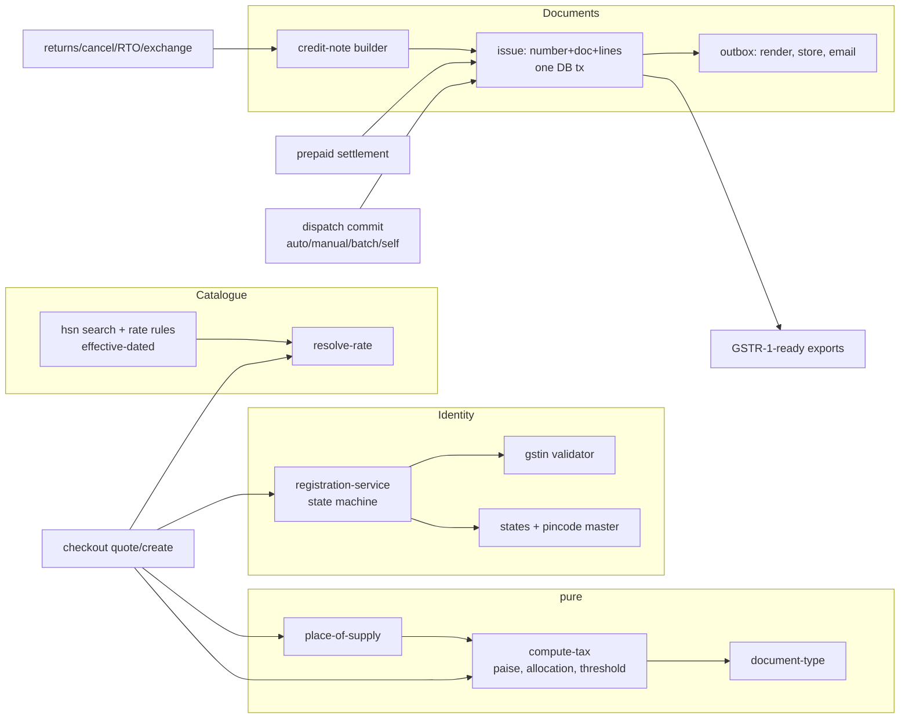
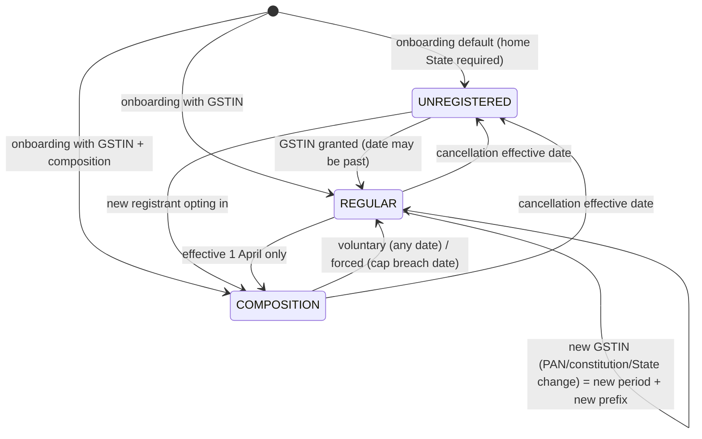

# 04 Target domain architecture (Stage 3, 2026-10-31)

Inputs: 01 (L-ids, O-closure safe defaults) and 02 (B-ids, file map, Appendix A). Nothing here is code.

Revised after the S4 review (s4-review.md, R-001..R-043; resolution table at the end of that file). Decisions D-41..D-51 were added in that pass.

**Tags.** `LAW L-x` = confirmed legal requirement (P grade in 01), and only for the exact proposition that P-grade text covers. Anything beyond it is tagged REC or CA. `LAW* L-x` = official text, but a dated compilation, so amendments need a re-check (goes on the CA list). `CODE B-x` = observed code behaviour (02). `REC-H/M/L` = recommended architectural decision, with confidence. `CA` = needs CA confirmation. `3P` = needs third-party API verification.

---
## 1. Invariants (hold in every work package)
| # | Invariant | Tag |
|---|---|---|
| I-1 | ShopPulse never collects, holds, settles or pays out customer money. All storefront money moves only on the seller's own gateway keys. No payouts, Route/transfers, commission or platform-key fallback | REC-H (architectural policy); CODE 02 §4. GST trigger text LAW L-028 (s.52). Income-tax side: L-040 is a FAQ snippet (S grade, despite its P label in 01) → CA (classification) |
| I-2 | An issued tax document is immutable data. It can only be corrected by a later credit or debit note. The PDF is a derived artefact that can be rebuilt from the stored snapshot | LAW L-011; CODE B-31; REC-H |
| I-3 | No silent defaults: missing tax data, an unknown State or an unresolvable rate raises a typed error. Never fall back to 0% or IGST | CODE B-09, B-11; REC-H |
| I-4 | All tax arithmetic uses integer paise. Storage is `Decimal(12,2)`. No JS floats in tax paths | CODE B-14; REC-H |
| I-5 | Dates that matter to tax (FY, issue date, effective dates) are IST calendar dates (fixed UTC+05:30) | CODE B-17; REC-H |
| I-6 | Rates, HSN codes, thresholds and State lists are data (effective-dated rows or a verified constant). Nothing is hand-typed into logic | L-039 (U); CODE B-23; REC-H |
| I-7 | The supplier identity used for a sale is resolved by date from registration history and snapshotted on the order and the document | REC-H |
| I-8 | Every customer-facing charge and the included GST are shown before the pay step. Charged total = displayed total | LAW L-035 |

## 2. Modules (new `src/lib/tax/**`; old `src/lib/billing/{order-tax-engine,hsn-lookup,gst-compliance,storefront-tax-schemas}` and `invoice/{generate,numbering,cod-paid}` are removed)

## 3. Decision register
| ID | Decision | Tag |
|---|---|---|
| D-01 | Split identities. The **ShopPulse billing profile** (seller as buyer of the SaaS) is a new `SaasBillingProfile` on User. The **store tax registration** (seller as supplier) is a new `StoreTaxRegistration`. A SaaS-invoice toggle never changes storefront tax status | CODE B-04, B-05; REC-H |
| D-02 | Seller regime enum is `UNREGISTERED \| REGULAR \| COMPOSITION`. Legal constitution is a separate field (individual/proprietor ≠ unregistered). Casual, non-resident, SEZ-unit, ISD, TDS/TCS registrants and the handicraft PAN route are not supported in MVP; onboarding says so | LAW L-023 (do not build); REC-H |
| D-03 | Registration history is append-only. Each row is a period `[effectiveFrom, effectiveTo)` holding regime, GSTIN, PAN, State and constitution. Core fields are immutable per row, so a change creates a new row. Non-core fields (trade name, address) are edited in place, and documents keep their own snapshot. Transition rules: 03 §9 | REC-H |
| D-04 | `UNREGISTERED` and `COMPOSITION` ship to the home State only. Enforced at pincode check, quote, checkout, dispatch and pickup scheduling. A registered seller can also opt in to home-State-only. For UNREGISTERED this is an MVP policy that also covers exempt/nil-only sellers (whom L-021 does not force to register), so seller copy says "on ShopPulse" and does not present it as law | LAW L-021 (inter-State taxable supply needs registration); blanket rule = REC-H policy; composition bar LAW* L-029 + CA |
| D-05 | Every pickup address carries a validated `stateCode`. For dispatch it must equal the active registration State. Additional places of business are later work | O-3 safe default; CA; CODE B-33 |
| D-06 | Tax engine = one pure function (§5). Each tax component is rounded half-up at line level, and document totals are line sums. In inclusive mode, taxable = gross − Σ components, so CGST always equals SGST and the line total stays exact | CODE B-14; REC-H; CA (rounding convention) |
| D-07 | Every customer-facing amount is tax-inclusive. The engine also supports exclusive mode (`pricesIncludeTax=false`), but there is no UI for it in MVP. The mode is snapshotted on the order and the document | CODE B-26; REC-H |
| D-08 | Taxable value starts from the **selling price** (minus any future on-invoice discount). MRP is a display ceiling only (`sellingPrice ≤ MRP`). Order-level coupons (future) are apportioned to lines before the engine runs. A post-supply discount is always a credit note | LAW* L-002; L-003 (S, stricter rule); REC-H |
| D-09 | Rates come from an effective-dated `GstRateRule` catalogue that a script imports from the official schedule. Each product stores HSN, taxability and `rateMode` CATALOGUE (rate follows the catalogue by date) or MANUAL (seller rate, flagged for review when the catalogue changes). The old 87-row JSON catalogue is deleted | L-039 (U) → CA; CODE B-23; REC-H |
| D-10 | Per-piece value thresholds (apparel ₹2,500) are tested per piece on the taxable value after discount; at or below the threshold gets the low rate. With inclusive prices, a per-piece gross above T×(1+low) and at or below T×(1+high) has no self-consistent rate (₹2,625.01–₹2,950.00 for 5/18, cess counted in the rate). That band is **not sellable**: the product form rejects it, and the engine raises `TaxNotSellable` if a future discount lands there. Valid prices are ≤ ₹2,625.00 or ≥ ₹2,950.01. Charges inherit the goods line's outcome and are never threshold-tested | L-037 P covers only "5% up to ₹2,500"; per-piece, pre-tax basis and 18% are S → CA; CODE B-10; REC-H |
| D-11 | Seller-billed shipping (fixed or variable) and the COD fee are part of the value of supply and are taxed with the goods. Allocation is `PROPORTIONAL_TO_VALUE` (default) or `HIGHEST_RATE_LINE` (store option); each order snapshots the method. Each allocation becomes a charge line that inherits its goods line's HSN, taxability and rate | LAW* L-001, L-004; L-005 (no guidance) → CA; CODE B-08 |
| D-12 | Courier freight, the courier's COD charge, insurance and gateway fees billed to the seller are seller costs and never enter the engine. MVP has no convenience fee or gift wrap | L-006 (S); REC-H |
| D-13 | Place of supply comes from one resolver: the ship-to State derived from a pincode master (the State dropdown is filled from the pincode and cannot conflict with it). B2B with buyer-GSTIN State ≠ ship-to State is **blocked** in MVP; the buyer may continue as B2C. The resolver can be swapped once a CA rules | O-2 → CA; CODE B-11; REC-H |
| D-14 | Supply type: regime ≠ REGULAR → NONE. Same State → CGST + SGST, or CGST + UTGST for UTs without a legislature (flag on the State master). Different State → IGST | IGST/UTGST Acts not in 01 → CA; REC-H |
| D-15 | Document type comes from a pure function: UNREGISTERED → `COMMERCIAL_INVOICE` (not a GST document, no tax). COMPOSITION → `BILL_OF_SUPPLY` with legend. REGULAR → `TAX_INVOICE` if all lines are taxable, `BILL_OF_SUPPLY` if none are. Mixed carts default to a **two-member sale set** (TAX_INVOICE for taxable lines + BILL_OF_SUPPLY for the rest, D-41). `INVOICE_CUM_BILL_OF_SUPPLY` stays hidden until a CA confirms Rule 46A's scope | LAW L-013 (s.31(3)(c), BoS for exempt and composition); composition legend LAW* L-012 (Rule 5); Rule 46A scope U → CA; unregistered document title → CA; CODE B-06, B-07 |
| D-16 | Issue trigger. **PREPAID:** issued in its own transaction right after the settlement transaction commits, on both entry paths (webhook and verify). Captured money is never rolled back by a tax failure: the order stays PAID with `saleDocumentStatus=FAILED`, the reconcile job retries, and the seller is alerted. **COD:** at dispatch commit, before the first courier call. Every dispatch path (auto, manual, batch, and self-ship when added) requires `saleDocumentStatus=ISSUED` before the courier call; COD issues at that point. Both triggers come before removal | LAW L-010; CODE B-03; REC-H; owner approved 31 Oct |
| D-17 | Classification inputs are frozen at checkout (D-43). The regime and the catalogue rate are resolved on the **issue date**, and gross always stays at the quoted inclusive amount. Every date that matters is kept (placed, captured, issued, removed, collected) so a CA-confirmed change-in-rate rule can be applied. When a published rate change or a scheduled transition affects open orders (prepaid with a FAILED sale set, COD not yet dispatched), those orders are flagged and the seller can **Issue invoice now** before the effective date (issuing before removal is allowed). Before a transition that bars inter-State supply, those orders must be dispatched or cancelled (D-45) | s.14 opened by S4 but truncated → CA (blocks only the change-in-rate branch); LAW L-010 (pre-removal issue); REC-M |
| D-18 | Number format is `{PREFIX}-{K}{YY}-{NNNNNN}`, at most 16 characters, `[A-Z0-9-]` only. The counter is per (prefix, kind, FY), incremented with `UPDATE … RETURNING` inside the issue transaction. Any error rolls back the whole transaction, counter included, so there are no gaps and no collisions. Numbers are globally unique. Prefixes (2–5 chars, store-derived) are globally unique with bounded auto-heal; a prefix is never shared by two GSTINs and is locked once the FY's first document is issued. At sequence 999,999 the series rolls to a new auto-derived prefix (warning from 900,000). Details: §6 | LAW L-008 (16-char limit only); charset and per-FY uniqueness wording → CA; global uniqueness and no gaps = REC-H; CODE B-02, B-16 |
| D-19 | Documents are snapshots: `TaxDocument` (supplier, recipient, place of supply, totals) plus `TaxDocumentLine`. They never read live product, store or order data after issue. `Payment` loses every invoice and tax column | LAW L-008 fields; CODE B-31; REC-H |
| D-20 | The PDF pipeline runs outside the DB transaction, through an outbox that is the **only writer** (D-46). Rendering uses the snapshot plus a persisted `renderVersion` and `brandingSnapshot` (logo copied to an immutable asset at issue, footer text). Upload is Cloudinary raw/authenticated with public id `shoppulse/{storeId}/tax-documents/{fy}/{docId}.pdf` (`.pdf` included, owner decision). `overwrite:true` is allowed only while `pdfStoredAt` is null, which adopts an orphan upload from a failed DB write; after that, `overwrite:false`. The upload response's `public_id`, `version`, `resource_type`, `type` and `format` are persisted verbatim; a URL is never parsed. A download that finds the asset missing streams a fresh render and re-queues the outbox; it never uploads itself. A re-render whose hash differs is logged, and the document data stays authoritative | CODE B-01, B-19; owner decision 31 Oct; 3P (account PDF-delivery setting, owner to check) |
| D-21 | Email goes through an outbox row per delivery, with retry and backoff. A delivery is eligible only once the PDF is STORED. Delivery is at-least-once: a provider message id is recorded, and a rare duplicate is accepted. "No email provider" is recorded and shown to the seller, never swallowed. The customer download link reuses the existing HMAC link token | CODE B-20; REC-H |
| D-22 | Credits run through a `TaxCorrection` created by the **business event**, never by a refund rail: cancellation confirmed after the sale set, RTO received, return inspection decided with a refund amount, or exchange returned leg accepted. Inside one transaction holding the Order row lock, the correction takes the remaining per-line balances (original minus earlier corrections), writes its lines, and issues one credit note per original document it touches. Refund legs (any rail, any number, failed or retried) link to the correction, not to a note. The value is the refunded value only; a retained restocking or reverse-shipping fee is not credited. **Identity:** the note uses the original document's registration, supplier snapshot and prefix (kind C, FY of the note's date). **Nature:** `GST_CREDIT_NOTE` only when the original was a taxable GST document of a registration that has not been cancelled or replaced; otherwise `COMMERCIAL_CREDIT_NOTE`. `declarationDeadline` = 30 Nov after the original FY, or the seller-entered annual-return date for that FY if earlier; exports and warnings use it, and actual declaration is the seller's filing | LAW L-011; Rule 53 (U) → CA; CODE B-12, B-13 |
| D-23 | Exchange = `TaxCorrection(EXCHANGE_RETURN)` for the returned item + a separate **replacement sale set** (source key `EXCH:{exchangeId}`). The set is built from a replacement snapshot frozen at exchange approval (product classification, rate inputs, gross, buyer/ship-to). It is issued at the earlier of difference-payment settlement or replacement dispatch commit, under the registration active on that date. The difference paid or refunded is a money leg linked to the replacement set or the correction | REC-M; CA |
| D-24 | B2B invoicing is an optional store setting. Buyer GSTIN is validated (format, checksum, PAN, State). B2B is disabled while the store's declaration says AATO exceeded ₹5 cr in **any** FY since 2017-18 (`aatoEverAbove5Cr`, D-48), until an IRP integration exists | L-016 P covers the ₹5 cr threshold of 10/2023; the "any preceding FY" wording is S → CA; REC-H |
| D-25 | Printed HSN digits follow the previous-FY AATO tier from the declaration of the document's FY (D-48): 4 up to ₹5 cr, 6 above. Products store up to 8 digits; the minimum on entry is the current tier's digit count | LAW L-014 |
| D-26 | E-way bill: when a shipment's consignment value (sum of the grand totals of the sale-set members whose goods are in it) is > ₹50,000, pickup scheduling is blocked until a valid EWB record exists. The record holds number, date, valid-until, the document numbers covered, the consignment value, and from/to pincodes. It is cleared and re-blocked on rebooking, an address or pincode change, or a sale-set re-issue; pickup is also blocked when valid-until is before the pickup slot. Manual entry in MVP; courier Part-A authorisation is future work. A per-State intra-State threshold lives in the State master | L-019 is a P explainer only; in-force rule, value basis and unregistered-consignor scope → CA; 3P (Shiprocket EWB field) |
| D-27 | Enforcement: once registered, any product that is not tax-ready cannot be **bought** (checkout 409, "temporarily unavailable" on the product page). Products are never archived or mutated. Scheduled effective dates give preparation time. The 3-day grace window and the archive cron are removed | CODE B-09, 02 #4; REC-H |
| D-28 | Turnover monitor: warns at 75/90% of the registration threshold (unregistered) or the composition cap, using ShopPulse FY sales plus the declared other turnover (D-48). Unregistered status never changes automatically. **Composition lapse is automatic.** At every COMPOSITION sale-set issue, under a per-store advisory lock, if FY turnover (ShopPulse + declared other + this sale) exceeds the cap, the system records a forced COMP→REG transition effective that IST day; the sale and every later one are issued as REGULAR. Earlier same-day Bills of Supply, and those after a late-declared breach date, are listed for the CA | s.10(3) "shall lapse with effect from the day" (CBIC page opened by S4) → LAW; LAW L-024, LAW* L-029; CA (same-day documents) |
| D-29 | Composition is fully modelled (§4): eligibility from the FY declaration (PAN-wide previous-FY AATO ≤ the cap for the home State's class), plus seller attestations (every registration on this PAN opts in; not a manufacturer of notified goods), and the same-PAN check across ShopPulse stores under a PAN advisory lock. Composition products must be tax-ready like REGULAR ones, so a forced lapse is seamless. Home-State only, Bill of Supply with legend, no tax anywhere customer-facing, opt-in effective 1 April, exit at any date with form checklists, quarterly turnover export with an estimated composition tax. No product-level composition block | s.10(2) proviso and (2)(e) (opened by S4); LAW* L-029, L-032, L-033; L-030/L-031 (S) → CA (notified-goods list) |
| D-30 | GSTR-1-ready CSV exports built only from document tables: B2B, B2C summary, credit/debit notes, HSN summary (B2B/B2C), document summary, plus a composition quarterly summary. The CA validates the layout | L-015 (U) → CA; REC-M |
| D-31 | One GSTIN validator (format + checksum + State code + embedded PAN), enforced server-side. Live GSTN lookup is future work | CODE B-18, B-28; 3P |
| D-32 | Retention: tax documents and their PDFs are never deleted by any job. The app never deletes a store; it is only disabled/inactive, and an export-everything ZIP is offered | s.36 not in 01 (O-8) → CA; owner decision 31 Oct |
| D-33 | Audit trail = the append-only domain rows (registrations, documents, order snapshots) plus structured logs. No activity-log table, no actor columns (single-user app) | owner rule; REC-H |
| D-34 | Verification: no automated tests and no test scripts. After implementation, the implementing model writes a manual, step-by-step UI testing guide that the owner follows | owner decision 31 Oct (overrides brief §7/§8 item 08) |
| D-35 | Shiprocket gets a single payload builder used by auto, manual and batch. It is built from the issued sale-set lines (never from the checkout quote): item HSN, rate, inclusive unit price, charges, document number, and a COD collectable equal to `Order.codAmount`. Shiprocket's invoice generation is never called | CODE B-21; 3P (field semantics) |
| D-36 | Compliance behaviour (document type, blocks, numbering) is on every plan. Only exports and reports may be plan-gated | REC-M |
| D-37 | ShopPulse's own SaaS series moves to ≤16 characters (`SP/26-27/000042`, 15 chars; S4's "14" is a miscount). Already-numbered SaaS payments keep their numbers; resend and retry reuse the stored number. The new format applies only to new allocations on the same FY counter. SaaS PDFs get the D-20 storage contract (persisted ids), and old assets get their ids once through the prefill script | LAW L-008 (16-char limit); CODE B-16 |
| D-38 | Position: the prepaid sale set is issued at the receipt of payment, so no unbilled advance remains. s.31(3)(d) allows "a receipt voucher or any other document, containing such particulars as may be prescribed", so whether the invoice suffices (also for composition and exchange-difference payments) needs CA confirmation. Fallback ready: `RECEIPT_VOUCHER`/`REFUND_VOUCHER` types and series are reserved, so a voucher can be added at settlement without schema change | LAW L-010; s.31(3)(d) opened by S4; CA (launch blocker, not a build blocker) |
| D-39 | Tax classification is product-level. Variants inherit it, and the per-piece threshold is tested on each variant's own price | REC-H |
| D-40 | UQC comes from a constant loaded from the official GST UQC list, defaulting from the catalogue, and is snapshotted per line | CODE B-25; 3P (data source) |
| D-41 | **Sale set.** One sale source (an order, or an exchange replacement) produces 1–2 member documents (`MAIN`; plus `BOS` for split mixed carts), issued in **one** transaction. `issueKey` = `SALE:{sourceKey}:{member}`, `saleSetKey` = sourceKey. `Order.saleDocumentStatus` (PENDING, ISSUED, FAILED, LEGACY_EXCEPTION) and `saleDocumentsIssuedAt` are set in the same transaction. Corrections may span both members (one note per member) | REC-H |
| D-42 | **Locks.** Order row `FOR UPDATE` for sale-set issue, dispatch claim, corrections and cancellation of that order. Store row `FOR SHARE` during any issue, and `FOR UPDATE` for registration transitions and prefix edits, so transitions wait for in-flight issues and vice versa. `pg_advisory_xact_lock(hash(PAN))` for composition opt-in; per-store advisory lock for the composition cap check | REC-H |
| D-43 | **Frozen checkout inputs.** `Order.supplierSnapshot` and, per OrderItem, the classification (HSN, taxability, UQC, rateMode, manual rate and threshold params, piecesPerUnit, catalogue rule id). Issue reads only these plus registration and catalogue rows by date; it never reads the live Product or a mutable identity field. Order and OrderItem tax amounts stay the **checkout quote** forever. Issued values live only in documents, and UIs show "Invoiced GST" from documents once they exist, "Estimated GST" before that | REC-H |
| D-44 | **Dispatch claim.** The existing shipment-creation claim (02 trace (b), `claimShipmentCreationAttempt`) is shared by auto, manual and batch: one active forward booking per order, and cancellation is refused while a booking claim is active. Before a retry, an existing Shiprocket booking is adopted by our order id (3P). Pickup scheduling re-checks: not cancelled, sale set ISSUED under the active registration, ship-to allowed, pickup State, valid EWB. A permanent booking failure leaves the sale set; the seller retries or cancels (correction) | CODE AUTO:379; REC-H; 3P |
| D-45 | **Stale identity at dispatch.** If the sale set's registration (GSTIN or regime) differs from the active one, dispatch is blocked. If ship-to is still allowed, the seller re-issues (correction + new sale set under the active registration, gross unchanged); otherwise the seller cancels (correction + refund). This also covers a changed pickup State | REC-M; CA (re-issue practice) |
| D-46 | **Outbox claims.** PDF jobs and email deliveries are claimed separately with a fencing token and a 10-minute lease (render and upload each time out at 2 minutes). Completion writes only `WHERE claimToken = ours`, so a stale worker cannot overwrite newer state | REC-H |
| D-47 | **Recovery.** Reconcile issues sale sets only for orders that are not yet removed: PAID prepaid with PENDING/FAILED status, issued as of the run date, which is still before removal. An order removed without a sale set is an exception shown to the seller and the CA, never silently "fixed" with a new-date document | LAW L-010; REC-H |
| D-48 | **FY declaration** (`StoreTaxYearDeclaration`, one per store per FY): previous-FY AATO tier and PAN-wide amount, `aatoEverAbove5Cr`, other turnover, annual-return filing date, last threshold alert level. A reminder runs each 1 April; until the seller declares, the previous FY's values carry over with a banner | LAW L-014, L-016, L-011; REC-H |
| D-49 | **Money precision.** Every money column that collects, settles or refunds a document widens to `Decimal(12,2)` (Order, OrderItem, OrderCharge, Payment, RefundLeg, ExchangeDetail, return fees, Shipment COD amount) | REC-H |
| D-50 | **Explicit out-of-scope items.** B-22 (variable shipping priced at 0.5 kg) goes to the shipping backlog; quote and checkout share one computation, so displayed = charged still holds. B-27 (`codRemitted`, insurance fields) goes to the shipping/finance backlog; "delivered" records **collection by the courier**, not remittance. B-30 (stale fallback comment) is removed in the payment work package | REC-H |
| D-51 | **Cutover.** The app server and crons stay stopped from prefill part 1 to Migration B (05 §5). Prefill never invents identity or geography: unresolvable cases come from an owner-supplied overrides file or become `LEGACY_EXCEPTION`. Prefill never changes money columns | REC-H; owner approval pending (R-023) |

## 4. Seller regime state machine (transition rules, freezes and checklists: 03 §9)

Rules: a falling turnover never moves the regime by itself; only the legal registration event does (copy warns "keep charging GST until your cancellation date"). The exception is the composition lapse, which is automatic (D-28). A scheduled, not-yet-effective row can be deleted. **Date rules (authoritative here and in 03 §9):** UNREG→REG any past date; forced composition exit = breach date; cancellation up to 30 days past or future; voluntary composition exit up to 7 days past; REG→COMP only on 1 April; everything else today or future (≤ 90 days). A backdated row shortens the previous row's `effectiveTo`. Orders and documents already referencing the previous row keep it and are listed for the CA, never altered. PAN is core, so a PAN change (even unregistered) creates a new row (reason `IDENTITY_CHANGE`). Onboarding's first row always starts on the store creation date. A future registration date at onboarding becomes an UNREG first row plus a scheduled row.

Composition specifics: see D-29. The same-PAN check never reveals the other store. Storefront: no GST rows, Bill-of-Supply legend on every document. Reports: quarterly turnover plus estimated tax at the seller-entered composition rate (informational).

## 5. Tax engine contract (`computeOrderTax`, pure, no I/O)
Input: `regime`, `sellerStateCode`, `placeOfSupplyStateCode`, `stateKind(pos)`, `pricesIncludeTax`, `allocation`, `lines[{key, qty, unitPricePaise, discountPaise, piecesPerUnit, taxability, rate: FLAT{rateBps,cessBps} | PER_PIECE_THRESHOLD{thresholdPaise, lowBps, highBps, cessBps}, hsn, uqc}]`, `charges[{key, kind, grossPaise}]`. Rates come from `resolveRate(frozenClassification, date)` before the call: the product at quote time, the OrderItem's frozen classification at issue time (D-43).

Steps:
1. Guard: if REGULAR, every line needs a taxability and a resolvable rate, otherwise `TaxNotReadyError(productIds)`. Non-REGULAR: all rates are forced to 0 and the supply type is NONE.
2. Supply type and components by D-14.
3. Goods line gross `G = qty·unit − discount`. Threshold rule: per-piece gross `p = unit/piecesPerUnit` (after discount). Inclusive test: `p·10000 ≤ T·(10000+low)` gives low; `p·10000 > T·(10000+high)` gives high; anything between is DEAD_ZONE, which raises `TaxNotSellable` (D-10). The rates in both tests include cess. Exclusive test: `p ≤ T` gives low.
4. Allocate each charge: PROPORTIONAL by G with largest-remainder paise (ties go to the lower index; if ΣG = 0 the charge goes to line 1), or HIGHEST_RATE (ties go to the larger G). Each allocation becomes a charge line with the goods line's HSN, taxability and resolved rate.
5. Each line, for each component rate `r`: inclusive `c = roundHalfUp(G·r / (10000+R))` with `R` = total rate including cess, then `taxable = G − Σc`. Exclusive: `c = roundHalfUp(G·r/10000)` and `total = G + Σc`.
6. Totals = Σ lines. `documentType = decideDocumentType(regime, taxabilities)`. Return lines, allocations, totals, warnings and `engineVersion`.

Example: ₹799 at 5% intra-State gives CGST 19.02, SGST 19.02 and taxable 760.96, total exact (fixes B-14).

Credit-note builder (pure): input is the original lines, the **remaining balances** read under the Order lock (D-22, D-42), the units or charge amounts being credited and the refunded gross per line. The gross is converted with the same inclusive formula at the original line's rate. When the credit reaches the full remaining value of a line, the exact remainders are used, so cumulative credits never exceed the original. A credit larger than the remaining balance raises `CreditExceedsBalance`.

## 6. Numbering and documents
- Kind letters: `I` tax invoice / invoice-cum-BoS, `B` bill of supply, `S` commercial invoice (unregistered), `C` credit note, `D` debit note, `R`/`V` reserved. `YY` = FY start year (FY 2026-27 → `26`). Sequence is 6 digits. Example `WIW-I26-000143` (14 chars). The prefix limit of 5 keeps every number ≤16.
- Prefix derivation (bounded): store name → uppercase alphanumerics. If fewer than 2 characters remain, use `S` + 4 random chars. Candidates in order: first 5 chars; first 4 + digit 2–9; first 3 + 2 random; 5 random. Stop after 30 attempts with `PREFIX_UNAVAILABLE`, and the seller types one. A reserved list includes `SP`. The seller may edit the prefix until the first document of an FY is issued (an edit creates a new prefix row; old rows are never renamed).
- Prefix and GSTIN: a prefix is bound to at most one GSTIN. Regime changes under the same GSTIN, and UNREGISTERED→registered (kind `S` vs `I`/`B`, so no clash), keep the prefix. A new registration row whose GSTIN differs from a GSTIN already used under the current prefix gets a new auto-derived prefix (e.g. `WIW2`), so each GSTIN's series stays clean for its own returns.
- Issue transaction (one, short): lock the Order `FOR UPDATE` and the Store `FOR SHARE` (D-42) → resolve the registration (for a sale: active on the issue date; for a correction: the original document's) → build the snapshot → `upsert` series → `UPDATE series SET lastNumber=lastNumber+1 RETURNING` (if the result is > 999,999: roll the prefix, D-18) → insert the documents and lines with unique `issueKey`s → set the order status fields → enqueue PDF and email. The function never catches errors inside the transaction. On P2002 for `issueKey`, the whole transaction (counter included) rolls back, and the caller re-reads and returns the existing documents. On any other P2002 it rolls back, retries once, then alerts. There is no rendering or network I/O inside the transaction (fixes B-19).
- `issueKey` patterns: sale `SALE:ORDER:{orderId}:{MAIN|BOS}`, replacement `SALE:EXCH:{exchangeId}:{MAIN|BOS}`, correction note `CORR:{correctionId}:{originalDocumentId}`. Correction `sourceKey` (unique per business event): `CANCEL:{orderId}`, `RTO:{shipmentId}`, `RETURN:{returnRequestId}`, `EXCH:{exchangeId}`, `REISSUE:{orderId}:{n}`.
- Reconcile job: D-47.

## 7. Error handling, concurrency, logging
- Typed errors mapped to HTTP: `TaxNotReady` 409 (product ids), `ShipToStateNotAllowed` 422, `PlaceOfSupplyUnresolved` 422, `B2bStateMismatch` 422, `QuoteChanged` 409 (with a fresh quote), `DocumentIssueFailed` 500 (outbox retries).
- Checkout: `POST /checkout/quote` returns the full breakdown and an HMAC quote token (15 min). Create recomputes and rejects any difference (I-8).
- Locks: D-42. Registration writes lock the Store row (`FOR UPDATE`) so periods stay contiguous and never overlap.
- New typed errors: `TaxNotSellable` 409, `CreditExceedsBalance` 409, `StaleRegistrationAtDispatch` 409, `PrefixUnavailable` 409.
- Logs: `tax.quote`, `tax.document.issued`, `tax.document.pdf_failed`, `tax.registration.changed`, `tax.reconcile.fixed` (structured, no PII beyond ids).

## 8. Removed or replaced (02 verdicts)
`order-tax-engine.ts`, `hsn-lookup.ts` + `hsn-reference.json`, `gst-compliance.ts` + the `enforce-gst-grace` cron, its banner and `run-compliance-check`, `invoice/generate.ts`, `invoice/numbering.ts`, `invoice/cod-paid.ts` (COD cash reconciliation moves to the delivered handler), `storefront-tax-schemas.ts`, `StoreInvoiceCounter`, all Store GST/grace/invoice columns, Payment invoice/tax columns, `Order.tax`, Shiprocket `generateInvoice()`, the duplicate `gstin.ts` validator. Kept: link token, Cloudinary client (behind a `DocumentStorage` interface), `indian-states.ts` (extended), the bulk-edit concept, the SaaS Decimal pattern.
