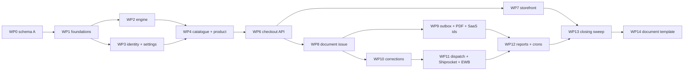

# 07 Implementation roadmap (Stage 5, 2026-10-31)

Inputs: 00-brief §12, 03, 04, 05, 06, s4-review.md (S3 resolutions), 01 closure table. Tags as in 04. D-ids = 04, S-ids/M-ids = 05, B-ids = 02, CA-/3P-/OW- ids = 09.
Path shorthand: `T/` = `src/lib/tax/` · `API/` = `src/app/api/` · `DASH/` = `src/app/(dashboard)/[storeId]/(routes)/` · `STORE:` = ShopPulseStore repo · CHK, VER, SETTLE, WHK, SRW, AUTO, SHIP, REF, DC, CLD, GEN, NUM, COD, TPL, BILL, STX = 02 aliases.

## Rules for every work package
| # | Rule | Tag |
|---|---|---|
| G-1 | **No automated tests and no test scripts** (D-34). "Acceptance" = checks the implementer and owner do by hand in the UI, Prisma Studio, the dummy Shiprocket server or the Cloudinary console, plus `npx tsc --noEmit` (see G-3 for what "passing" means until the last WP), `npm run lint` and `npm run build` (last WP onward). After WP14 the implementing model turns every acceptance list into one manual step-by-step UI testing guide (`notes/tax/10-manual-ui-testing-guide.md`) | owner decision 31 Oct |
| G-2 | **The schema is final and already applied** (WP0 expand migration, then the `tax_domain_drop_legacy` contract migration, both on a cleared dev DB, owner decision 31 Oct). No WP changes the schema. Any newly found schema need stops the WP and goes to the owner as an additive migration request | brief §8; 05 M-7 |
| G-3 | **Legacy tax columns and `StoreInvoiceCounter` no longer exist** (05 §3 "Remove" list is applied). `npx tsc --noEmit` errors that mention a removed field are the worklist. Each WP, in the files it owns (ownership table below), rewrites every such usage onto the new model: it never re-adds a column and never keeps a compatibility shim. A WP is done when `tsc` shows **no error in any file it owns and no new error anywhere**; errors left in files owned by later WPs are expected. The app is **not started** until the final WP; manual UI acceptance items are run once the WPs they depend on are in (the WP log notes which checks were deferred) | owner decision 31 Oct |
| G-4 | Money columns are never changed by any WP or script (D-49 widening in WP0 is a type change, guarded by the WP0 pre-check) | D-51; R-023 |
| G-5 | A legacy module is deleted in the WP that removes its last caller (listed per WP). `git grep` for its import must return nothing before deletion | REC-H |
| G-6 | Start each WP from a clean, committed tree. The tree currently has unrelated uncommitted edits, some in files WP6/WP8 change (`DASH/orders/[orderId]/components/order-types.ts`, `.../sections/billing-tab.tsx`): owner commits or shelves them first (OW-05) | CODE (git status 31 Oct) |
| G-7 | Every route keeps today's auth model (06 header). Every typed error uses `T/errors.ts` and the body `{ code, message, details }` (06 §7) | REC-H |
| G-8 | Each WP ends with a ≤10-line entry in `notes/tax/_progress.md` (done, open, acceptance results) | brief §0 |

## Planning decisions made in this stage
| ID | Decision | Tag |
|---|---|---|
| P-01 | WP order below. Identity (WP3) comes before catalogue (WP4) because readiness needs the regime; WP4 then adds the readiness count to the transition pre-checks | REC-H |
| P-02 | **Withdrawn.** No prefill and no rehearsal run: the dev DB was cleared on 31 Oct 2026 and the old dev orders were simulations. Stores, products, addresses and orders are created fresh through the new onboarding and checkout | owner decision 31 Oct |
| P-03 | **Done / moot.** The money-column pre-check is not needed on an empty DB; the columns are already `Decimal(12,2)` | owner decision 31 Oct |
| P-04 | The PDF pipeline (WP9) uses `renderVersion = 1`: the existing TPL adapted to read only the document snapshot and print every 03 §7 field. WP14 adds `renderVersion = 2` (the visual redesign); v1 stays in code (D-20) | REC-M |
| P-05 | COD "delivered" stops issuing invoices in WP8 (collection record only), the same WP that deletes GEN, so no window exists where COD issues through the legacy path | REC-H |
| P-06 | Every removal path goes through the dispatch gate (D-44): create, assign-courier, generate-awb, `awb`, batch, auto-ship and **self drop-off** (`mark-dropoff`). The pickup re-check and EWB gate (D-26) cover `request-pickup`, `retry-pickup`, `pickups/batches` and the `pickup-scheduler` cron | REC-H; CODE (route list 31 Oct) |
| P-07 | Export-everything ZIP (D-32) is `GET API/[storeId]/tax/export?fy=` (additive to 06 §2) | REC-M |
| P-08 | Releases: WP6 + WP7 ship together (the new checkout requires a quote token the old storefront does not send). Until WP6 lands, checkout does not compile; nothing about orders is checked before then | REC-H |
| P-09 | **Clean slate.** Reference data (pincodes WP1, HSN catalogue WP4, subscription plans via `prisma/seed.ts`) is re-loaded by the owning WP's script; the plans are already seeded. Stores are created by onboarding (WP3 creates the registration, prefix, settings and declaration rows). `prisma/seed-products/index.ts` is rewritten in WP4 | owner decision 31 Oct |

## Compile-error ownership (baseline 31 Oct, 426 `tsc` errors after the contract migration)
Every error comes from a removed field. Owner WP rewrites the file (or deletes it, where the WP says delete). A file not listed here that later shows an error belongs to the WP whose area it sits in.
| Files | Owner |
|---|---|
| `src/lib/billing/gst-compliance.ts`, `API/cron/enforce-gst-grace/route.ts`, `API/[storeId]/settings/gst/run-compliance-check/route.ts`, `src/lib/notifications/platform/newindex.ts` (grace mails) | WP4 (delete / trim) |
| `API/[storeId]/settings/storefront-tax/route.ts`, `API/settings/billing/route.ts`, `src/lib/billing/buyer-profile.ts`, `src/lib/otp/dispatchers/store-dispatcher.ts`, `DASH/settings/billing-and-tax/page.tsx`, `src/app/(dashboard)/[storeId]/layout.tsx` (Store tax fields; the grace banner mount goes in WP4) | WP3 |
| `API/[storeId]/products/**` (incl. `bulk-tax`, `inventory`), `API/[storeId]/categories/[categoryId]/route.ts`, `DASH/products/**` (incl. `bulk-fix-tax`, `archived`, `view`), `prisma/seed-products/index.ts` | WP4 |
| `API/[storeId]/checkout/route.ts`, `API/[storeId]/order/[orderId]/{route.ts, tracking/route.ts}`, `API/[storeId]/orders/route.ts`, `src/lib/orders/order-list-where.ts`, `API/[storeId]/shipping/delivery-charges/route.ts`, `DASH/orders/[orderId]/page.tsx` | WP6 |
| `src/lib/billing/invoice/{generate.ts, numbering.ts, cod-paid.ts}` | WP8 (delete) |
| `API/[storeId]/storefront/orders/[orderId]/invoice.pdf/route.ts`, `.../invoice/email-resend/route.ts`, `src/lib/uploads/server/cloudinary-orphan-audit.ts` | WP9 |
| `src/lib/returns/tracking-hub-service.ts`, `DASH/returns/[returnId]/page.tsx` | WP10 |
| `API/[storeId]/shipments/[shipmentId]/route.ts`, `DASH/shipments/[shipmentId]/**`, `src/lib/shipping/{pickup-location-service.ts, pickup-sync.ts}` | WP11 |

## Dependency order

| WP | Name | Size | Fixes |
|---|---|---|---|
| WP0 | Schema (expand + contract, DONE 31 Oct) | S | (enables all) |
| WP1 | Foundations: money, FY, States, pincodes, UQC, GSTIN, errors | S | B-17, B-18, B-28, B-33 |
| WP2 | Tax engine (pure) | M | B-08, B-10, B-14 |
| WP3 | Seller identity, registration, settings, SaaS billing split | L | B-04, B-05, B-37 |
| WP4 | HSN catalogue + product tax + grace removal | L | B-09, B-23..B-25, B-29 |
| WP5 | (withdrawn, no prefill) | — | — |
| WP6 | Checkout quote + order snapshot (admin API) | L | B-11, B-15, B-26, B-34 |
| WP7 | Storefront display (ShopPulseStore) | M | B-15, B-32 |
| WP8 | Document issue core + prepaid trigger + reconcile | L | B-02, B-03, B-06, B-07, B-16, B-19, B-30, B-31 |
| WP9 | Outbox: storage, PDF v1, email, downloads, SaaS storage | M | B-01, B-20, B-36, B-16 (SaaS) |
| WP10 | Corrections: cancel, return, RTO, exchange, re-issue | L | B-12, B-13 |
| WP11 | Dispatch + Shiprocket payload + EWB + pickup gates | L | B-21, B-35 |
| WP12 | Reports, monitors, reminders, readiness, export | M | — |
| WP13 | Closing sweep (removed-name grep, tsc, lint, build, end-to-end run) | S | — |
| WP14 | Document template (visual), last | M | — (layout only) |
Out of scope (D-50): B-22, B-27; B-35 is handled in WP11 (forward-only DELIVERED branch).

---
## WP0 · Schema (DONE 31 Oct 2026: expand migration, DB cleared, contract migration)
**Status.** The final schema is applied: migrations `tax_domain_foundation` (expand) and `tax_domain_drop_legacy` (contract) on a cleared dev DB; legacy columns, `StoreInvoiceCounter` and the `PREFILL` / `LEGACY_EXCEPTION` enum values are gone; `Address.stateCode`, the Order tax identity fields and the OrderItem tax amounts are required. Plans re-seeded. The text below is kept as the record of what was specified; nothing in it is left to do.
**Goal.** Put the full end-state schema of 05 §1–§3 in place. (Originally: one additive migration with legacy columns kept.)
**Depends on.** OW-05 (clean tree), OW-02 if the pre-check finds rows.
- **Pre-check (read-only, P-03; not needed on the cleared DB):** for each column 05 §3 widens to `(12, 2)` (Order `subtotal, shippingCost, totalAmount, codAmount, codCharge, shippingEstimate`; OrderItem `productMrp, priceAtPurchase, lineTotal, taxableAmount, cgstAmount, sgstAmount, igstAmount, cessAmount`; Payment `amount`; RefundLeg `amount`; ReturnRequest `payAtSubmitWaivedInr, reverseShippingFeeInr`; ExchangeDetail `newPriceAtExchange, priceDifference`; Shipment `codAmount`) count rows where `value <> round(value, 2)` or `abs(value) >= 1e10`. Record row counts and `sum()` of each column in the WP log.
- **Change:** `prisma/schema.prisma` only.
- **Create:** `prisma/migrations/<ts>_tax_domain_foundation/` via `npx prisma migrate dev --create-only --name tax_domain_foundation`; review the SQL; then `npx prisma migrate dev`.
- **DB:** every enum and model in 05 §1–§2; every "Add / change" column in 05 §3. The M-1 list stays nullable (`Order.taxRegistrationId, sellerRegime, sellerStateCode, placeOfSupplyStateCode, supplyType, shippingStateCode, taxEngineVersion, supplierSnapshot`, `Address.stateCode`, existing OrderItem tax amounts). New relations `onDelete: Restrict` as in 05.

**Acceptance (met)**
1. `npx prisma validate` and `npx prisma format` clean; migrations applied from an empty DB; `npx prisma generate` done.
2. `tsc` reports errors only for removed fields (see the ownership table); they are the worklist for WP3–WP11.

**Don't touch.** Existing migrations, no hand-edited SQL.

---
## WP1 · Foundations (shared utilities and reference data)
**Goal.** The small, reused building blocks every later WP imports.
- **Create:** `T/money.ts` (paise ↔ `Prisma.Decimal`, `roundHalfUpDiv`, no floats), `T/fy.ts` (fixed UTC+05:30 IST date, `financialYearOf`, `fyShort`), `T/errors.ts` (typed errors + HTTP map, 04 §7, 06 §7), `T/geo/states.ts` (extends `src/lib/billing/indian-states.ts`: code, name, kind, registration-threshold class, composition-cap class, intra-State EWB limit; source = 3P-05), `T/geo/uqc.ts` (official UQC list, 3P-05), `T/geo/pincodes.ts` (lookup), `T/identity/gstin.ts` (merge of `src/lib/billing/gst-validators.ts:52-76` and `src/lib/billing/gstin.ts:28-65`; format, checksum, State code, embedded PAN; S-5), `scripts/tax/import-pincodes.ts` (M-2; prints source file name, date and row count).
- **Change:** `src/lib/billing/billing-schemas.ts` (use `T/identity/gstin.ts`).
- **Delete:** `src/lib/billing/gstin.ts`, and the validator functions of `gst-validators.ts` once unused (G-5).
- **DB:** writes `Pincode` only.

**Acceptance**
1. Import of the chosen directory file (3P-04) reports its row count; a lookup of `110001` gives `07` and `560001` gives `29`; a pincode listed under two States returns both codes.
2. In today's billing form, a GSTIN with a wrong last character, a wrong State prefix or a PAN mismatch each shows a clear error (one validator, server-side).
3. Code review: `financialYearOf` treats `2027-03-31T18:30:00Z` (= 1 Apr 00:00 IST) as FY `2027-28`; nothing in `T/` uses `Date#getMonth()` without the IST offset (B-17).
4. `tsc` shows no new error and none in the files WP1 touched.

**Don't touch.** Checkout, the engine, Store tax code (WP3), storefront repo.

---
## WP2 · Tax engine (pure)
**Goal.** `computeOrderTax`, `decideDocumentType` and the credit-note builder exactly as 04 §5 and 03 §5, with no I/O.
- **Create:** `T/engine/compute.ts` (guard, supply type, threshold test incl. dead zone, allocation, inclusive/exclusive maths, totals, `engineVersion`), `T/engine/document-type.ts`, `T/engine/credit-note.ts`, `T/engine/types.ts`.
- **DB:** none.

**Reference values** (hand-checked; WP4 preview, WP6 quote, WP8 documents and WP10 notes must show exactly these; inclusive mode, intra-State unless stated)
| # | Input | Expected |
|---|---|---|
| R1 | ₹799 @ 5% | CGST 19.02, SGST 19.02, taxable 760.96 |
| R2 | ₹799 @ 5%, inter-State | IGST 38.05, taxable 760.95 |
| R3 | ₹1,180 @ 18% | CGST 90.00, SGST 90.00, taxable 1,000.00 |
| R4 | apparel rule (₹2,500/piece, 5/18), ₹2,625.00 | 5%: CGST 62.50, SGST 62.50, taxable 2,500.00 |
| R5 | same rule, ₹2,800.00 | `TAX_NOT_SELLABLE` |
| R6 | same rule, ₹2,950.01 | 18%: CGST 225.00, SGST 225.00, taxable 2,500.01 |
| R7 | A ₹1,000 @ 5% + B ₹500 @ 18% + shipping ₹50, proportional | shipping A 33.33 / B 16.67; A goods CGST=SGST 23.81, taxable 952.38; B goods 38.14 each, taxable 423.72; A shipping 0.79 each, taxable 31.75; B shipping 1.27 each, taxable 14.13; tax 128.02; total 1,550.00 |
| R8 | R7 with `HIGHEST_RATE_LINE` | all ₹50 shipping on B: CGST=SGST 3.81, taxable 42.38 |
| R9 | 2 × ₹799 @ 5% (line CGST=SGST 38.05, taxable 1,521.90); credit 1 unit, then the last unit | note 1: CGST=SGST 19.02, taxable 760.96; note 2 (exact remainder): CGST=SGST 19.03, taxable 760.94; notes sum to the line |
| R10 | COMPOSITION or UNREGISTERED, any cart | all components 0; type BILL_OF_SUPPLY / COMMERCIAL_INVOICE |
| R11 | REGULAR, one TAXABLE + one EXEMPT line | sale set MAIN (TAX_INVOICE) + BOS (BILL_OF_SUPPLY) |

**Acceptance**
1. Code review against 04 §5: integer paise only (no `number` arithmetic on rupees), half-up per component per line, inclusive `taxable = G − Σc`, largest-remainder allocation with the stated tie rules, `TaxNotReady`/`TaxNotSellable`/`CreditExceedsBalance` raised, never a silent 0% or IGST (I-3).
2. No import of Prisma, fetch, env or date-now inside `T/engine/**`.
3. R1–R11 reproduce when the engine is first exercised through the UI (WP4 preview for R1–R6, WP6 quote for R2, R7, R8, R10, R11, WP10 for R9).

**Don't touch.** `src/lib/billing/order-tax-engine.ts` stays until WP6 removes its caller.

---
## WP3 · Seller identity, registration history, settings, SaaS billing split
**Goal.** Store tax identity as dated registration periods (D-01..D-05, D-42, D-48, 03 §9, §14a–b); ShopPulse's own billing profile separated from it.
**Depends on.** WP1.
- **Create:** `T/identity/registration-service.ts` (`getActiveRegistration`, `scheduleTransition` with the 04 §4 date rules, `cancelScheduled`, eligibility pre-checks, PAN attestation + `pg_advisory_xact_lock(hash(PAN))`, Store `FOR UPDATE`; S-1, S-2), `T/identity/declarations.ts` (D-48 carry-over, HSN tier, B2B gate), `T/identity/ship-scope.ts` (`canShipTo`), `T/documents/numbering.ts` **prefix part only** (bounded derivation, auto-heal, reserved list incl. `SP`, GSTIN binding, edit lock; S-7). Routes: `API/[storeId]/tax/registration/route.ts`, `.../tax/registration/transitions/route.ts`, `.../transitions/[id]/route.ts`, `.../tax/settings/route.ts`, `.../tax/declarations/[fy]/route.ts`, `API/settings/saas-billing-profile/route.ts`. UI: new cards in `DASH/settings/billing-and-tax/` (registration + history + "Change GST status" wizard, invoice settings, FY declaration, ShopPulse billing details; copy from 03 §14a–b).
- **Change:** onboarding is **not touched** in WP3 (owner decision 1 Nov 2026). Instead `notes/tax/onboarding-tax-step-content.md` specifies the future onboarding tax step (screens, fields, copy, validation, backend contract `setupInitialRegistration`). Until it is built, a fresh store sets up its first registration, prefix, `StoreTaxSettings` and declaration from the setup form in the Billing & Tax registration card (`POST API/[storeId]/tax/registration`); BILL, `API/settings/billing/me/route.ts`, `API/subscription/billing-identity/route.ts`, `src/app/(dashboard)/subscription/components/billing-preflight-modal.tsx`, `billing-tax-form.tsx`, `src/lib/billing/subscription-tax.ts`, `subscription-issue.ts`, `shoppulse-profile.ts` → read/write `SaasBillingProfile` only.
- **Delete:** `storefront-tax-form.tsx`, `gst-compliance-status.tsx`, STX, `src/lib/billing/storefront-tax-schemas.ts` (G-5).
- **Also fix (G-3):** every `tsc` error from removed Store fields in the files WP3 owns (ownership table); the settings setup form (later: onboarding) creates the registration, prefix, `StoreTaxSettings` and declaration rows so a fresh store is fully usable.
- **DB:** writes `StoreTaxRegistration`, `StoreTaxSettings`, `StoreTaxYearDeclaration`, `DocumentPrefix`, `SaasBillingProfile`.

**Acceptance**
1. New store, "Not registered" in the setup form: one UNREG row from the store creation date (IST), prefix derived from the store name and shown in Invoice settings. A second store with the same name gets a different, auto-healed prefix. Prefix `SP` or a taken prefix is refused live.
2. Setup (or the wizard) with a GSTIN whose State ≠ Home State, or whose PAN ≠ entered PAN, is refused with the 03 §14a copy.
3. Toggling "GST invoice for my ShopPulse subscription" (settings and the subscription pre-flight modal) never changes the registration card (B-04); clearing it never leaves a store "registered" (B-05).
4. Wizard date rules: UNREG→REG with a past date accepted; REG→COMP only on a 1 April; voluntary COMP→REG more than 7 days back refused; cancellation more than 30 days back refused; anything more than 90 days ahead refused. History shows contiguous periods; a backdated row shortens the previous one.
5. A scheduled change can be deleted before its date; core changes ask for the OTP.
6. Two stores on one PAN: composition opt-in on one asks for the all-registrations attestation and never names the other store.
7. A new-GSTIN transition creates a new prefix; a regime change under the same GSTIN keeps it.
8. Declaration card saves this FY; the B2B toggle is disabled while `aatoEverAbove5Cr` is true.

**Don't touch.** Checkout, product APIs, document issue.

---
## WP4 · HSN catalogue, product tax data, grace-policy removal
**Goal.** Effective-dated catalogue and the new product tax fields (D-09, D-10, D-27, D-39, D-40; 03 §10, §11, §14c).
**Depends on.** WP2, WP3.
- **Create:** `scripts/tax/import-catalogue.ts` (file → `TaxCatalogueVersion` DRAFT with `HsnCode` + `GstRateRule` rows, verification per row, `--publish` makes it the single PUBLISHED version; S-6), `T/catalogue/search.ts`, `T/catalogue/resolve-rate.ts` (`resolveRate`, `isTaxReady`), `T/catalogue/product-tax-schema.ts` (shared zod), `API/tax/hsn/search/route.ts`, `API/tax/hsn/[code]/rate/route.ts`, `API/[storeId]/tax/readiness/route.ts` (products part).
- **Change:** `API/[storeId]/products/route.ts`, `.../products/[productId]/route.ts`, `.../products/[productId]/inventory/route.ts`, `.../products/bulk-tax/route.ts`; `DASH/products/[productId]/components/{product-form.tsx, product-tax-compliance.tsx, product-basic-details.tsx}` (labels "incl. GST", preview, readiness chip, dead-zone rejection), `DASH/products/bulk-fix-tax/**` (apply to selected, new fields, no auto-unarchive), product view pages, product archive/restore (write and read `ArchivedProduct.taxSnapshot`, B-29); `registration-service.ts` pre-check gains "products not tax-ready" count.
- **Delete:** `API/cron/enforce-gst-grace/route.ts` + its `vercel.json` entry and scheduler entry, `API/[storeId]/settings/gst/run-compliance-check/route.ts`, `src/components/banners/gst-grace-banner.tsx` + its mount in `src/app/(dashboard)/[storeId]/layout.tsx`, grace mail templates in `src/lib/notifications/platform/templates.ts`, `gst-compliance.ts` once uncalled. `hsn-lookup.ts` and `hsn-reference.json` stay until WP6 (the old checkout engine still imports them).
- **Also fix (G-3):** every `tsc` error from removed Product/Category/Store fields in the files WP4 owns (ownership table), including `prisma/seed-products/index.ts` (seed products with HSN, UQC, rate source and tax-inclusive price).
- **DB:** writes catalogue tables and the new Product columns.

**Acceptance**
1. Import a catalogue file to DRAFT, then publish: exactly one PUBLISHED version. A rule marked UNVERIFIED is never used: the product shows "pick rate manually".
2. Product form: searching "t-shirt" suggests HSN codes; with a verified rule the rate is read-only; "Set manually" needs the confirmation tick.
3. Preview for ₹799 at 5% shows "GST inside ₹38.04 · taxable ₹760.96" (R1, home State). Apparel rule: ₹2,625.00 accepted at 5% (R4); ₹2,800 rejected with the 06 §7 copy (R5); ₹2,950.01 accepted at 18% (R6).
4. Readiness chip: a REGULAR store's product without HSN shows "Missing: HSN"; the readiness route lists it; the product is **not** archived.
5. Bulk tool applies HSN/rate to 3 selected products in one go; archive then restore keeps their tax fields.
6. The grace cron, banner and compliance-check route are gone; `git grep gst-compliance` returns nothing.

**Don't touch.** Checkout, `order-tax-engine.ts`, `hsn-lookup.ts` (WP6). Catalogue **data** quality is CA-19, not this WP: dev may use a small DRAFT file.

---
## WP5 · Withdrawn (no prefill)
The DB was cleared on 31 Oct 2026 and the legacy columns were dropped at once (P-02). Nothing to build. The id is kept so references to WP6..WP14 stay valid.

---
## WP6 · Checkout quote and order snapshot (admin API)
**Goal.** One computation for quote and create; Order, OrderItem and `OrderCharge` hold the immutable checkout quote (D-06, D-07, D-11, D-13, D-14, D-24, D-27, D-43; I-8).
**Depends on.** WP4. Released together with WP7 (P-08).
- **Create:** `T/geo/place-of-supply.ts`, `T/checkout/quote.ts` (engine input from cart + registration + address; HMAC quote token, 15 min), `API/[storeId]/checkout/quote/route.ts`, `src/lib/shipping/delivery-charge-service.ts` (shared in-process function extracted from DC).
- **Change:** CHK (quote token, `QUOTE_CHANGED`, readiness 409, `canShipTo`, POS, B2B rules, Order/OrderItem/OrderCharge writes, no Payment tax columns, no self-HTTP at CHK:456-467), DC (`shipToAllowed`, `reason`, `stateCodes`), `src/lib/billing/storefront-b2b.ts` (B2B from settings + declaration), `API/[storeId]/order/[orderId]/route.ts`, `DASH/orders/[orderId]/components/{order-types.ts, sections/overview-tab.tsx, sections/billing-tab.tsx}` ("Estimated GST" from the Order).
- **Delete:** `order-tax-engine.ts`, `hsn-lookup.ts`, `src/lib/billing/data/hsn-reference.json`, `gst-compliance.ts` if still present.
- **DB:** writes Order snapshot columns, `OrderCharge`, OrderItem quote + frozen classification.
- **Also fix (G-3):** every `tsc` error from removed Order/OrderItem/Payment fields in the files WP6 owns (ownership table); all orders from here on are created fresh.

**Acceptance** (quote checked through WP7's UI; before that with the quote route)
1. R1 shipped in-State gives CGST/SGST 19.02; R2 (other State) gives IGST 38.05; R7 and R8 cart splits match exactly.
2. UNREG or COMP store, out-of-State pincode: 422 `SHIP_TO_STATE_NOT_ALLOWED` at the pincode check and the quote (B-34).
3. REG store with a not-ready product: 409 `TAX_NOT_READY` listing it.
4. B2B with GSTIN State ≠ ship-to: 422 `B2B_STATE_MISMATCH`; with `aatoEverAbove5Cr`: 422 `B2B_NOT_AVAILABLE`.
5. Price edited between quote and pay: 409 `QUOTE_CHANGED` with a fresh quote.
6. Order row: `supplierSnapshot`, `taxRegistrationId`, `placeOfSupplyStateCode`, `pricesIncludeTax`, `chargeAllocation`; `OrderCharge` SHIPPING and COD_FEE rows whose allocation JSON sums to their gross; `totalAmount` = Σ line gross + Σ charges = quote total = Razorpay amount.
7. Admin order page shows "Estimated GST ₹x" (not ₹0, B-15).

**Don't touch.** Settlement and invoice code (WP8).

---
## WP7 · Storefront display (ShopPulseStore repo)
**Goal.** Buyer sees the labels and the full breakdown before paying (I-8, 03 §13; L-035).
**Depends on.** WP6 (same release).
- **Change (STORE:):** product price component(s) (find the PDP price block; 02 App. B #8), `src/app/(routes)/cart/components/checkout-summary.tsx` (remove "Tax (Included) ₹0"), `src/app/(routes)/checkout/page.tsx`, `.../checkout/components/{order-summary.tsx, address-form.tsx, b2b-form.tsx}` (quote call, quote token on create, pincode → State auto-fill, out-of-State message, B2B errors), `src/components/order/tax-breakdown-card.tsx`, `src/actions/get-order-details.tsx` (Estimated/Invoiced GST labels), `src/lib/gstin.ts` (same algorithm as `T/identity/gstin.ts`; the server stays authoritative).
- **DB:** none.

**Acceptance**
1. REG store PDP: "Inclusive of all taxes"; MRP struck when higher. UNREG/COMP store: no GST wording except "MRP (incl. of all taxes)" when MRP is shown.
2. Cart: "Includes GST ₹x" from the quote (REG); no GST row for UNREG/COMP.
3. Checkout before pay: items, shipping, COD fee when COD is picked, GST included (CGST/SGST or IGST split for B2B), total. The Razorpay amount equals the shown total.
4. Pincode fills the State; a conflicting State cannot be chosen. UNREG/COMP store and another-State pincode: "This seller delivers only within {State}."
5. Price changed in the dashboard during checkout: "Prices were updated. Please review your total." and the new total.

**Don't touch.** Storefront payment keys, unrelated pages, client-side tax maths (none allowed).

---
## WP8 · Document issue core, prepaid trigger, reconcile, composition lapse
**Goal.** Sale sets with gap-free, ≤16-char numbers, issued at settlement for prepaid (D-15, D-16, D-18, D-19, D-28, D-41, D-42, D-47; 04 §6; S-3, S-4, S-8, S-10, S-12).
**Depends on.** WP6.
- **Create:** `T/documents/numbering.ts` series part (`upsert` + `UPDATE … RETURNING`, roll at 999,999, warn at 900,000, format assert), `T/documents/issue.ts` (`issueSaleSet`, `issueCorrectionNotes` scaffold, no catch inside the transaction, P2002 on `issueKey` → re-read), `T/documents/snapshots.ts`, `T/documents/repository.ts` (insert + artefact updates only), composition cap check + forced lapse in `registration-service.ts` (per-store advisory lock), `API/[storeId]/orders/[orderId]/documents/route.ts`, `API/[storeId]/orders/[orderId]/issue-now/route.ts`, `API/cron/tax-document-reconcile/route.ts` (+ scheduler entry).
- **Change:** SETTLE, VER, WHK (after the settlement transaction commits, both paths call `issueSaleSet(ORDER, PAYMENT_SETTLED)`; failure → `FAILED` + seller alert; money never rolled back), COD delivered paths (SRW:422-433, `API/[storeId]/shipments/[shipmentId]/delivered/route.ts`, `.../status/route.ts`) → `recordCodCollection` only (`isPaid`, `paidAt`, `codCollectedAt`; P-05), admin order page Documents panel (list) and "Invoiced GST" from documents, RZP (remove stale comment, B-30).
- **Delete:** GEN, NUM, `cod-paid.ts`, the GEN calls in WHK:152-161, 253-262, `StoreInvoiceCounter` usage (the model is already gone; rewrite or delete every caller).
- **DB:** writes `DocumentSeries`, `TaxDocument`, `TaxDocumentLine`, Order `saleDocumentStatus`, `saleDocumentsIssuedAt`, `codCollectedAt`, forced `StoreTaxRegistration` rows.

**Acceptance**
1. Prepaid order paid: status ISSUED; one TAX_INVOICE numbered like `WIW-I26-000001` (≤16 chars), issue date n IST; document lines equal the quote (R1/R7 values).
2. Pay with the store webhook disabled (verify callback only): still issued (B-03).
3. The first invoices of two different stores both issue (B-02).
4. Mixed REG cart (taxable + exempt): `-I26-` and `-B26-` documents sharing one `saleSetKey` (R11). COMP store: BILL_OF_SUPPLY with the legend; UNREG: `-S26-` commercial invoice (B-06, B-07).
5. Replaying the verify call after the webhook creates no second document.
6. Orders paid during the WP6–WP7 window (PAID, PENDING, no documents) are issued by the next reconcile run with trigger RECONCILE.
7. "Issue invoice now" on an undispatched COD order issues it (trigger ISSUE_NOW); the button is gone once issued.
8. COMP store with declared other turnover just under the cap: the order that crosses it shows a forced COMP→REG row effective today and is issued as TAX_INVOICE.
9. Dummy Shiprocket DELIVERED for a COD order sets `codCollectedAt`; no document is created.

**Don't touch.** PDF/email (WP9), dispatch (WP11), refunds (WP10), document financial columns after insert (S-3).

---
## WP9 · Outbox: storage contract, PDF v1, email, downloads, SaaS storage ids
**Goal.** Durable, retryable artefacts that never parse URLs (D-20, D-21, D-37, D-46; 06 §5; P-04).
**Depends on.** WP8; OW-04 (Cloudinary setting) for acceptance 2.
<!-- NOTE: OWNER NOTE: yep its implemented1 -->
- **Create:** `T/documents/storage.ts` (`DocumentStorage` + Cloudinary adapter: raw, authenticated, public id `shoppulse/{storeId}/tax-documents/{fy}/{docId}.pdf`, `overwrite` only while `pdfStoredAt` is null, ids persisted verbatim), `T/documents/outbox.ts` (separate PDF and delivery claims, fencing token, 10-min lease, backoff 1m/5m/30m/2h/12h; S-11), `T/documents/render/v1.tsx` (TPL adapted: snapshot only, every 03 §7 field, HSN digits per document, POS name + code, UQC, unit price, cess, reverse charge "No", charge lines), `API/cron/tax-document-outbox/route.ts` (+ scheduler entry), `API/[storeId]/tax-documents/[docId]/pdf/route.ts`, `.../[docId]/resend/route.ts`, `API/[storeId]/storefront/orders/[orderId]/documents/route.ts` + `.../documents/[docId]/pdf/route.ts`; STORE: order page documents list.
- **Change:** CLD (behind the adapter; URL parsing removed), `src/lib/billing/invoice/email.ts` (outbox deliveries, `SKIPPED_NO_PROVIDER` recorded), `link-token.ts` (kept, scoped to documents), `src/lib/notifications/platform/newtemplates/paymentReceived.ts` (document links), `subscription-numbering.ts` (`SP/{yy-yy}/{6}` for new allocations only), `subscription-issue.ts` + `API/subscription/payments/[paymentId]/{invoice.pdf, resend-invoice}/route.ts` (persisted storage ids), `DASH/orders/[orderId]/components/invoice-button.tsx` → Documents panel actions.
- **Delete:** `API/[storeId]/orders/[orderId]/invoice.pdf/route.ts`, `API/[storeId]/storefront/orders/[orderId]/invoice.pdf/route.ts`, `.../invoice/email-resend/route.ts`, TPL once v1 replaces it.
- **DB:** writes `pdf*` columns, `TaxDocumentDelivery`, SubscriptionPayment storage-id columns.

**Acceptance**
1. Within one outbox run of issue: `pdfStatus=STORED`; DB holds `pdfPublicId` ending `.pdf`, `pdfVersion`, `pdfResourceType=raw`, `pdfDeliveryType=authenticated`, `pdfFormat`, bytes, sha256.
2. Admin download and customer download (link token) both open the PDF.
3. Delete the asset in the Cloudinary console: download still streams a PDF; `pdfStatus` returns to PENDING; the next run re-stores it (B-01 regression).
4. Store without an email integration: delivery shows `SKIPPED_NO_PROVIDER` in the Documents panel. Resend adds a new delivery row.
5. Two outbox calls fired together store and send once.
6. PDF v1 for each type (tax invoice, BoS, commercial invoice) shows every 03 §7 field (B-36).
7. New subscription payment: `SP/26-27/0000NN` (15 chars); resend of an older one keeps its old number; SaaS PDF downloads use persisted ids.

**Don't touch.** Document financial columns, numbering, `tax-documents/**` assets (never deleted).

---
## WP10 · Corrections: cancel, return, RTO, exchange, re-issue
**Goal.** Every reduction runs through a `TaxCorrection` created by the business event, with balances under the Order lock (D-22, D-23, D-45; 03 §12; S-9, S-12).
**Depends on.** WP8.
- **Create:** `T/corrections/service.ts` (`createCorrection(kind, sourceKey, lines)`, balances, one note per original document, `noteNature`, `declarationDeadline`, refund-leg linkage), `issueCorrectionNotes` completed in `T/documents/issue.ts`, `API/[storeId]/orders/[orderId]/reissue/route.ts` (OTP).
- **Change:** `src/lib/returns/storefront-order-cancel-service.ts` (Order lock, `BOOKING_IN_PROGRESS`, CANCELLATION correction before the refund leg), REF (COD fee from `codCharge`, B-12; RETURN correction at the inspection decision; legs carry `taxCorrectionId`), `API/[storeId]/returns/[returnId]/{inspect, process-refund}/route.ts`, `src/lib/returns/return-completion-service.ts`, `src/lib/returns/exchange-service.ts` + `API/[storeId]/returns/pay-exchange-diff{,-batch}/**` (freeze `replacementSnapshot` at approval; EXCHANGE_RETURN correction; replacement `issueSaleSet(EXCH)` at the earlier of difference settlement or replacement dispatch), SRW (RTO delivered → RTO correction), `src/components/orders/cancel-order-dialog.tsx`, return pages (credit-note numbers on the refunds tab), Documents panel (notes + deadline warning from 1 Oct).
- **DB:** writes `TaxCorrection`, `TaxCorrectionLine`, note documents, `RefundLeg.taxCorrectionId`, `ExchangeDetail.replacementSnapshot`.

**Acceptance**
1. Prepaid order cancelled before dispatch: `-C26-000001` note for the full value; refund leg linked to the correction. Cancelling during an active booking claim: `BOOKING_IN_PROGRESS`.
2. COD order cancelled before dispatch: no document at all.
3. Return 1 of 2 units of R9, then the other: notes equal R9 exactly; the two notes sum to the original line.
4. Return with a ₹50 restocking fee: note gross = refunded gross only.
5. Running the inspection decision twice creates no second correction (unique `sourceKey`); a manual over-credit gives `CREDIT_EXCEEDS_BALANCE`.
6. Return touching both members of a split sale set: two notes, one per original.
7. COD-fee refund amount equals `codCharge`, not the order total (B-12).
8. RTO delivered (dummy server): RTO correction for the remaining balance.
9. Exchange: approval stores the snapshot; the returned item gets a note; paying the difference issues a replacement set with `saleSetKey` `EXCH:{id}`.
10. Note against an UNREG original or a replaced registration: `COMMERCIAL_CREDIT_NOTE` under the original identity and prefix.

**Don't touch.** Refund-rail splitting logic (Razorpay legs, manual UTR) beyond linking; issued documents.

---
## WP11 · Dispatch gate, Shiprocket payload, e-way bill, pickup re-checks
**Goal.** One dispatch path for every removal; COD issues here; courier data comes from the issued documents (D-04, D-05, D-16, D-26, D-35, D-44, D-45; 06 §6; P-06).
**Depends on.** WP10 (re-issue), 3P-02 for payload field semantics.
- **Create:** `src/lib/shipping/dispatch.ts` (claim via `src/lib/shipping/shipment-creation-attempt-service.ts`, `canShipTo`, pickup-State check, sale set ISSUED under the active registration or COD issue, `STALE_REGISTRATION_AT_DISPATCH`, adopt an existing booking by our order id, pickup-time re-check incl. EWB validity), `src/lib/shipping/shiprocket-payload.ts`, `API/[storeId]/shipments/[shipmentId]/eway-bill/route.ts`.
- **Change:** AUTO, SHIP, `src/lib/queue/pickup-queue.ts`; `API/[storeId]/shipments/{route.ts, v2/route.ts, batch/route.ts}`, `.../shipments/[shipmentId]/{assign-courier, generate-awb, awb, mark-dropoff}/route.ts`, `.../shipments/{request-pickup, retry-pickup}/route.ts`, `API/[storeId]/pickups/{route.ts, batches/route.ts}`, `API/cron/pickup-scheduler/route.ts`; pickup locations (`API/[storeId]/shipping/pickup-locations/**`, `src/lib/shipping/pickup-location-schema.ts`, `default-pickup-location.ts`: validated `stateCode`); SRW (DELIVERED handled for forward shipments only, B-35); `src/lib/shipping/shiprocket-api.ts` (delete `generateInvoice()` 977-991); ship dialogs in `src/components/shipping/**` and the order page (disabled reasons, EWB form, Re-issue button); `dummy-server/**` mirrors the verified fields.
- **DB:** writes Shipment EWB columns and `consignmentValue`; clears them on rebooking, address change or re-issue.

**Acceptance**
1. COD order → Ship: the sale set is issued first, then the courier is called; if issue fails, no courier call happens.
2. Prepaid order with a FAILED sale set: Ship disabled with "Invoice not issued".
3. Pickup address in another State than the registration: `PICKUP_STATE_MISMATCH`.
4. Order of ₹50,000.01: pickup scheduling (manual, batch, cron, retry) blocked with `EWAY_BILL_REQUIRED`; after entering a 12-digit EWB with a future valid-until, allowed; changing the delivery address clears it and blocks again; a valid-until before the slot blocks. ₹50,000.00 is not blocked.
5. Dummy-server log for auto, manual and batch bookings shows the same payload: HSN, rate %, inclusive selling price, `shipping_charges`, `transaction_charges`, `invoice_number` = our document number, COD collectable = `Order.codAmount` (B-21).
6. Double-click Ship, or auto-ship racing a manual ship: one booking only. Self drop-off (`mark-dropoff`) obeys the same gate.
7. Registration changed (new GSTIN) after the sale set: `STALE_REGISTRATION_AT_DISPATCH`; Re-issue produces a note under the old identity and a new set under the new one; then Ship works.
8. Seller help text "Do not print Shiprocket invoices…" is shown; `generateInvoice` no longer exists.

**Don't touch.** Courier selection and rates, weight logic (B-22), `codRemitted` and insurance fields (B-27), reverse-pickup flows except the RTO hook.

---
## WP12 · Reports, monitors, reminders, readiness, export
**Goal.** Seller-facing compliance aids built only from document tables (D-28 warnings, D-30, D-32, D-36, D-48; 06 §4).
**Depends on.** WP9, WP11.
- **Create:** `T/reports/{gstr1, hsn-summary, documents-summary, composition-quarter}.ts`, `API/[storeId]/tax/reports/{gstr1, hsn-summary, documents, composition}/route.ts`, `API/[storeId]/tax/export/route.ts` (P-07), `API/cron/tax-threshold-monitor/route.ts`, `API/cron/tax-registration-reminders/route.ts` (+ scheduler entries; `TaxReminderLog` dedupe), readiness route completed (pickup mismatch, pending EWB, outbox failures, review-required products, removed-without-document exceptions) + dashboard banner/checklist.
- **Change:** plan gating for reports only (D-36); any store-disable or Cloudinary cleanup code excludes `tax-documents/**` (D-32).
- **DB:** writes `TaxReminderLog`, `StoreTaxYearDeclaration.lastThresholdAlertLevel`.

**Acceptance**
1. For an FY with mixed activity: B2B rows only for B2B documents; B2C summary grouped by POS and rate; credit/debit notes with original number and `declarationDeadline`; HSN summary split B2B/B2C at the document's digits; document summary per series. Each export's totals equal Σ of the documents.
2. Composition quarter export: turnover and the estimate at the entered composition rate.
3. Declared other turnover at 76% of the threshold: one warning; a rerun the same day sends nothing; at 91%: a second warning.
4. A transition scheduled 7 days ahead: one T-7 reminder. (The 1 April declaration reminder is checked by code review; first live run 1 Apr 2027.)
5. Readiness banner lists each problem type with a link to fix it.
6. Export ZIP contains every document PDF and the CSVs for the FY.

**Don't touch.** Document data; compliance behaviour stays on every plan (D-36).

---
## WP13 · Closing sweep (no cutover: no legacy data exists)
**Goal.** Prove nothing from the old model is left and the whole flow runs end to end.
**Depends on.** WP1–WP12 merged.
- **Steps:** `git grep` for every removed name in 05 §3 "Remove" (Store GST/grace/invoice fields, Payment invoice/tax fields, `Order.tax`, OrderItem `*Snapshot` + `appliedTaxSource`, `StoreInvoiceCounter`, `PREFILL`, `LEGACY_EXCEPTION`) across `src/`, `scripts/`, `prisma/`, `dummy-server/` → fix leftovers; delete stale files and comments that describe the old model; `npx prisma validate`, `npx tsc --noEmit`, `npm run lint`, `npm run build`; first start of the app; run one prepaid and one COD order end to end on a store created through onboarding.
- **DB:** none (no schema change, G-2).

**Acceptance**
1. `git grep` for the removed names returns nothing outside `prisma/migrations/**` and `notes/**`.
2. `tsc` has zero errors; lint and build pass.
3. One prepaid and one COD order complete: documents issue, PDFs store, a return creates a credit note.

**Don't touch.** Existing migrations; afterwards the M-7 freeze applies.

---
## WP14 · Document template (visual redesign), last
**Goal.** Final PDF design for every document type as `renderVersion = 2` (D-20, P-04). v1 stays in code for documents already rendered.
**Depends on.** WP13.
- **Create:** `T/documents/render/v2/**` (tax invoice, bill of supply, commercial invoice, credit note; shared layout; bundled fonts incl. ₹), logo from `brandingSnapshot`. Optional: same visual language for `subscription-template.tsx`.
- **Change:** current `renderVersion` constant → 2 for new documents only.
- **DB:** none.

**Acceptance**
1. Each type shows every 03 §7 field; title and legend per 03 §5; HSN printed at the document's digits; POS State name + code.
2. Long product names wrap; a 40-line order paginates with totals on the last page; ₹ renders.
3. Re-downloading an old v1 document still gives the v1 layout.

**Don't touch.** Document data, numbering, storage.

**After WP14:** the implementing model writes `notes/tax/10-manual-ui-testing-guide.md` from all acceptance lists (G-1).

---
## Launch gate (before hosting, not a WP)
| Item | Owner of the check |
|---|---|
| Every LAUNCH item in 09 answered by the CA, and any change it causes implemented | CA + owner |
| Catalogue published from the official schedule; rules the CA has not verified stay UNVERIFIED (sellers use MANUAL) | CA-19 |
| 3P-01..3P-05 verified; dummy server matches Shiprocket | owner |
| Pincode directory loaded from the licensed source | 3P-04 |
| Manual UI testing guide run end to end on a fresh store | owner |

