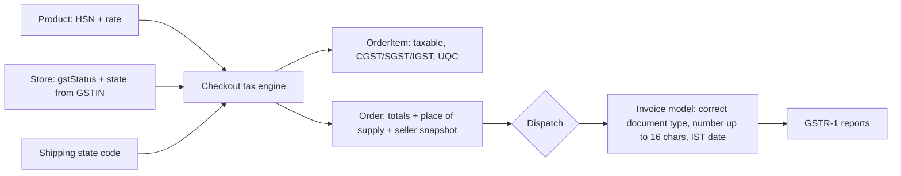

I audited the whole storefront GST flow (product → checkout → order → invoice) and checked the current law online. I only read code; nothing was changed. A CA still needs to check the final product rates — the platform can only give suggestions.

---

## 1. Basic GST concepts (short)

- **GST** is a tax the seller collects from the customer and pays to the government. Only a seller who is **GST-registered (has a GSTIN)** can collect it.
- **Same state** (seller and customer in the same state): the tax is split in two — **CGST + SGST**. In union territories without their own legislature (Chandigarh, Ladakh and a few others) the second half is called **UTGST** instead of SGST.
- **Different state**: a single **IGST** at the full rate.
- **HSN** is the product's category code, and the rate is decided by it. **Since 22 Sep 2025 ("GST 2.0") the main rates are 0%, 5%, 18% and 40%** (3% for jewellery). The 12% and 28% slabs are gone, and cess has been nil on everything (tobacco included) since 1 Feb 2026.
- **Inclusive pricing**: the ₹1,050 on the website already contains the GST. At 5%, the price before tax is 1000 and the tax is 50.
- **Invoice**: the legal bill. Each type of seller has to issue a different kind of document (details in section 5).

## 2. ShopPulse's legal role

Payments go straight into each merchant's **own Razorpay account**. So ShopPulse is a **software provider, like Shopify**, not a marketplace. That means ShopPulse does not have to collect the marketplace tax (TCS under GST) or deduct the marketplace TDS (Income Tax section 194-O).

- **Keep it this way.** If you later collect money into a ShopPulse account and pay merchants out of it, or build one common marketplace across stores, ShopPulse becomes an "e-commerce operator". That brings its own GST registration, TCS and monthly returns. Don't do that without a CA.
- **Your Terms of Service should say** that the merchant is the seller and is responsible for HSN codes, rates and invoices. ShopPulse's HSN suggestions are not tax advice.

## 3. What is already done right

- Tax is frozen per order line at checkout (HSN, rate, CGST/SGST/IGST).
- The same-state vs different-state split works.
- Buyer GSTIN checksum validation and the B2B opt-in work.
- Invoice counters run per store, per financial year, per invoice type, and can't collide.
- The apparel/footwear price rule is in the HSN catalogue and the seller can't override it.
- Products missing tax details get archived after the grace period, and GST settings changes are protected by OTP.

---

## 4. Critical mistakes (illegal, or wrong tax money)

| # | Problem | Why it's wrong | Fix |
|---|---|---|---|
| C1 | Invoice number `INV-2025-26-00042` is **17 characters** (`numbering.ts:47`). With an 8-character prefix it reaches 22. | Rule 46 allows **16 characters max**. | Use a format like `INV/2526/00042` (14) and limit the prefix to 5 characters. |
| C2 | **Every store's invoice is titled "Tax Invoice"** (`template.tsx:170`), even for unregistered sellers. | An unregistered seller can't issue a tax invoice. A composition seller or exempt goods need a "Bill of Supply". | Pick the document type from the seller's status (section 5). |
| C3 | The `isCompositionScheme` flag is saved but **the tax engine ignores it**. | A composition seller **can't collect GST** and **can't sell to other states**. | Composition store: zero tax, Bill of Supply, block deliveries to other states. |
| C4 | Switching back to INDIVIDUAL clears the GSTIN, but `gstRegistered` stays **true** (`route.ts:161`). | GST keeps being charged **without a GSTIN**, which is illegal. | Turn off GST when the GSTIN is removed (one status field, section 6). |
| C5 | **No GST on shipping or the COD fee** (`route.ts:901`). | Delivery and COD charges billed by the seller count as part of the sale and take the product's rate. Currently tax is under-reported. | Spread these charges over the order lines and tax them at each line's rate. |
| C6 | For COD orders the invoice is made **only after delivery** (`cod-paid.ts:73`). | For goods, the invoice must be issued **at or before dispatch**, and the parcel should carry it. | Issue the invoice at dispatch / courier booking, for both prepaid and COD. |
| C7 | The apparel/footwear ₹2,500 rule is checked against the **tax-inclusive price** (`hsn-lookup.ts:273`). | The law uses the **price before tax**. A ₹2,600 kurta is 2476 before tax, so 5% applies, but the code charges 18%. | Compare `inclusivePrice / 1.05` against 2500. For inclusive prices the cutoff is effectively **₹2,625**. |
| C8 | **The HSN catalogue rates are from before GST 2.0.** | Wrong rates. Verified examples: shampoo, hair oil, toothpaste and soap are now 5% (catalogue: 18%); chocolate and biscuits 5% (18%); pencils and exercise books 0% (12% / 18%); sanitary pads exempt (12%). **All 9 items at 12%** are definitely wrong, because that slab no longer exists. | Revise the catalogue with a CA. Show the rate as a suggestion and make the seller confirm it. |
| C9 | If a product has no HSN or rate, **0% tax is applied silently** (source `NONE`) and checkout isn't stopped. | Wrong tax, and the seller's liability. | For a registered store, block checkout for such products (or skip the grace period entirely). |
| C10 | The seller's `stateCode` is **not checked against the GSTIN** (the first 2 digits). The helper functions exist but nothing calls them. | A wrong state makes every CGST/IGST decision wrong. | Derive the state code automatically from the GSTIN. |
| C11 | If the shipping state isn't recognised, **IGST is applied silently** (`order-tax-engine.ts:131`). | Silent wrong tax. | Storefront should use a state dropdown; reject the checkout if the state can't be resolved. |
| C12 | The invoice prints **"Total tax: ₹0"** (it reads `Order.tax`, which is 0 for inclusive prices). There is **no COD fee row**, so the totals don't add up. | The invoice contradicts itself. | Print taxable value, CGST, SGST and IGST totals; add shipping and COD rows with their tax. |

## 5. Which document each seller must issue

| Seller | Document | GST shown? |
|---|---|---|
| Registered (regular) + taxable goods | **Tax Invoice** | Yes, CGST/SGST or IGST |
| Registered + only exempt or 0% goods | **Bill of Supply** | No |
| Registered + mix of taxable and exempt (B2C) | **Invoice-cum-Bill of Supply** | Only on the taxable lines |
| Composition seller | **Bill of Supply** with the line *"composition taxable person, not eligible to collect tax on supplies"* | No |
| Not registered | A simple "Invoice" or "Order receipt" | **Nothing about GST** |

**Things missing from the Tax Invoice today:**
- Unit price.
- Unit of quantity (PCS, PRS for pairs, etc.).
- Place of supply with the **state name** (only the code is printed now).
- A **"Reverse charge: No"** line.
- A COD row.
- Tax on shipping.
- A UTGST label for union territories.
- Dates in IST.

Also, a plain-text `_comment` in `hsn-reference.json` points to an internal planning note; it should be removed.

## 6. Medium issues (bad data or design)

1. **`priceMode`:** this is not the usual term. Shopify calls it "taxes included in prices" and WooCommerce uses `prices_include_tax`. It has **no UI or API**, so it is always INCLUSIVE and the EXCLUSIVE path is dead code. EXCLUSIVE is also risky for consumer (B2C) sales, because a packaged product can't be sold above MRP. **Rename it to `pricesIncludeTax Boolean @default(true)`** and keep it always true for now.
2. **`Order.tax` meaning:** it is 0 for inclusive orders. Rename it to `taxTotal` and always store the actual GST. Also add order-level totals: `taxableTotal`, `cgstTotal`, `sgstTotal`, `igstTotal`.
3. **`Payment` holds tax and invoice fields.** The Payment tax result fields (`taxableAmount`, `totalTax`, …) are **never written**. Tax facts like place of supply and the seller snapshot belong on **Order**. The invoice should be its own **`Invoice` model**, not part of Payment.
4. **`cessRate`** is obsolete now; remove it from Product and OrderItem. **The 12% and 28% slabs** are still in the product form's allowed list; remove them.
5. **`ucsCode`:** the correct term is UQC. The list is missing PRS, NOS, SET, DOZ, GMS and MLT. It is also **not saved on OrderItem**, but invoices and returns need it.
6. **Dates:** the financial year is calculated from the server's timezone (`numbering.ts:24`) and the invoice date is printed in UTC. An order at 12:30 AM on 1 April could land in the previous financial year. Use IST.
7. **Invoice SGST vs IGST label:** at invoice time it compares a state code ("27") with a state name, so the label can be wrong. Use the stored amounts instead.
8. **Rounding:** CGST and SGST are each rounded from half the tax, so they can be 1 paisa off. Compute them so that taxable value + tax equals the line total exactly.
9. **Two invoice-number settings:** `invoiceNumberFormat` (unused, up to 64 characters) and `invoicePrefix` (the one actually used). Keep only one.
10. **`einvoiceEnabled`:** the toggle exists but there is no connection to the government's invoice registration portal (IRP).
11. **Shiprocket:** it receives `hsn: ''` and `tax: 0` (`auto-ship-service.ts:368`). There is no e-way bill handling, though orders of ₹50,000+ need one. Also make sure Shiprocket's own invoice-printing feature is never used, so there is only one invoice series.
12. **Storefront:** the cart shows "Tax (Included) ₹0", which is misleading. The product page has no "Inclusive of all taxes" label.
13. **B2B orders:** if the shipping state differs from the buyer's GSTIN state, the buyer may lose the input tax credit (ITC) they would claim on their own GST. Show a warning; a CA should confirm the rule. The buyer's GSTIN is also not checked for being active.
14. **Pickup location:** if the pickup address is in a different state than the GSTIN, that's a problem — the seller needs a GSTIN in that state too. Add a check.

## 7. Missing features (needed for a real business)

- **Unregistered sellers selling to other states:** by law, anyone sending goods to another state must register for GST, whatever their turnover. Make **"deliver only in my state"** the default for non-GST stores, and let the seller lift it only with a written self-declaration (so the liability is on them).
- **Reports for the GST return (GSTR-1):** B2B invoices, large interstate B2C invoices (₹1 lakh+), state-wise B2C summary, HSN summary, document summary. Without this, a registered seller can't file returns.
- **E-way bill:** for orders of ₹50,000+, require the e-way bill number before booking the courier.
- **E-invoice (IRN) for B2B** when turnover is above ₹5 crore: either integrate the government invoice portal through a provider, or block B2B invoices for such stores.
- **HSN digits by turnover:** above ₹5 crore, 6-digit HSN is mandatory on every invoice. Recommend 6–8 digits in general, because many rates only become exact at that level.
- **GSTIN live check:** whether it is active, plus its legal name and address. Also turnover alerts for unregistered sellers approaching the registration limit.
- **Credit note:** if an invoice was issued and the order is cancelled before dispatch. Moving invoicing to dispatch time makes this case rare.

## 8. Target design

- **Store:** replace `gstRegistered` + `isCompositionScheme` with **one field: `gstStatus` = UNREGISTERED / REGULAR / COMPOSITION**, so impossible combinations can't happen. Add `pricesIncludeTax`, state code taken from the GSTIN, and the "deliver only in my state" restriction.
- **Product:** `hsnCode` (6–8 digits), `taxRate` (0/3/5/18/40), `taxBracketRule` (keep it, but compare the price before tax), `isExempt`, `uqc`. Remove `cessRate`.
- **OrderItem:** keep the current snapshots, add a UQC snapshot, remove cess.
- **Order:** `taxTotal`, `taxableTotal`, `cgstTotal`, `sgstTotal`, `igstTotal`, tax on shipping and the COD fee, place of supply state code, an inter-state flag, and snapshots of the seller's GST status and GSTIN.

**Example of the correct calculation.** A Maharashtra seller ships to a Karnataka customer: a T-shirt at ₹1,050 + shipping ₹59 + COD fee ₹30.
- T-shirt: before tax 1000.00, IGST 5% = 50.00.
- Shipping + COD (₹89 at the same 5%): before tax 84.76, IGST 4.24.
- Invoice: taxable 1084.76, IGST 54.24, total **1139.00**.
- Today the invoice shows only 50 tax, no tax on shipping, no COD row, and "Total tax ₹0".

## 9. Suggested order of work

- **P0 (before launch — legal):** C1–C12, document types, composition handling, the delivery restriction for non-GST stores, catalogue rates revised by a CA.
- **P1:** schema cleanup (section 8), GSTR-1 reports, e-way bill, storefront labels, B2B checks.
- **P2:** e-invoice (IRN) integration, GSTIN live check, turnover alerts.

## 10. Questions for a CA

1. When one order has items at different rates, should shipping and the COD fee be split proportionally across items, or taxed at the highest rate?
2. For B2B orders where billing and shipping states differ: is the place of supply the buyer's GSTIN state or the shipping state?
3. Correct rates for every catalogue HSN, especially the ones at 12%. Also whether made-up textiles (bed linen, curtains — HSN chapter 63) follow the ₹2,500 rule.
4. ShopPulse's "not a marketplace" position, and the Terms of Service wording.
5. Grace period, or immediate blocking, when a seller registers for GST?
